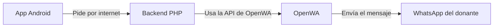
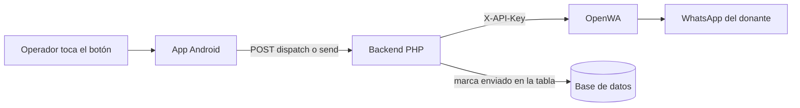

# Guía: Recordatorios por WhatsApp con OpenWA

Una guía paso a paso para **instalar OpenWA** y **agregar recordatorios de WhatsApp**
a una app Android sencilla (Java + pantallas XML, sin librerías raras).

Está escrita para alguien que está **aprendiendo a programar**. Por eso, cada vez que
aparece una palabra "técnica", la explicamos en criollo y con ejemplos. No hace falta
que sepas todo de antemano: la idea es que puedas copiar, entender y adaptar.

> **¿Qué vas a lograr?**
> Que tu app pueda mandar mensajes de WhatsApp **sola**, desde el servidor, sin que el
> operador tenga que abrir WhatsApp en su celular. Y que además puedas disparar los
> envíos con **un botón** cuando quieras.

> **¿No querés leer todo?** En la carpeta [`openwa-demo/`](openwa-demo/) están los
> mismos archivos **completos y listos para copiar** a tu proyecto (backend + Android),
> con un README corto. Esta guía explica *por qué* funcionan; la carpeta es el
> atajo.

---

## Índice

1. [La idea general](#la-idea-general)
2. [Glosario](#glosario)
3. [Parte A: Instalar Node.js](#parte-a-instalar-nodejs)
4. [Parte B: Instalar OpenWA](#parte-b-instalar-openwa)
5. [Parte C: El backend en PHP](#parte-c-el-backend-en-php)
6. [Parte D: La app Android](#parte-d-la-app-android)
7. [Diagramas de flujo](#diagramas-de-flujo)
8. [Como probar sin romper nada](#como-probar-sin-romper-nada)
9. [Problemas comunes](#problemas-comunes)

---

## La idea general

Imaginate que querés mandar una carta (un mensaje de WhatsApp). Vos no podés ir
hasta el correo a mano todo el tiempo, así que contratás a un **mensajero** que lo
haga por vos. Ese mensajero es **OpenWA**.

Pero el mensajero necesita que alguien le dé la carta ya escrita y le diga a quién
entregarla. Ese alguien es tu **backend** (un pequeño programa en un servidor). Y el
que le da la orden al backend (por ejemplo, *"mandá los pendientes ahora"*) es tu
**app Android**, cuando el operador toca un botón.

En dibujos, el recorrido es así:



**Lo más importante de todo:** la "llave" para usar OpenWA (se llama **API key**)
**vive en el servidor**, nunca en la app. Es como la llave de tu casa: no se la
repartís a todo el mundo. La app le pide al backend, y el backend es el único que
usa la llave.

### Los tres caminos para mandar un recordatorio

Vas a encontrar que se puede enviar de tres maneras. Acá las comparamos:

| Camino | ¿Quién envía? | ¿Depende del celular del operador? | Para qué sirve |
|---|---|---|---|
| **1. Botón → OpenWA** | El servidor (OpenWA) | No | Enviar recordatorios "de verdad", sin depender de nadie |
| **2. Botón → `wa.me`** | El celular del operador | Sí (abre su WhatsApp) | Envío rápido y a mano, uno por uno |
| **3. Automático (cron)** | El servidor (OpenWA) | No | Que se manden solos, sin apretar nada |

En esta guía vas a ver **los tres**, porque juntos cubren todo.

---

## Glosario

| Palabra | Explicación en criollo |
|---|---|
| **Backend** | Un programa que corre en un servidor (una computadora encendida siempre). Recibe pedidos y responde. En esta guía está en **PHP**. |
| **Servidor** | La computadora (o servicio) donde vive el backend. Puede ser tu propia PC con XAMPP. |
| **API** | La "puerta de entrada" de un programa. Le mandás un pedido y te devuelve una respuesta. |
| **API key** | Una contraseña larga que identifica que vos tenés permiso de usar la API. Es secreta. |
| **OpenWA** | Un programa hecho en **Node.js** que maneja un WhatsApp y permite enviar mensajes por internet. Es gratis y no oficial. |
| **Node.js** | El "motor" que necesita OpenWA para funcionar. Sin Node.js, OpenWA no arranca. |
| **Sesión** | La "cuenta de WhatsApp" que vinculaste escaneando un código QR. OpenWA le guarda un nombre/código para reconocerla. |
| **QR** | El código cuadradito que se escanea con el celular para vincular WhatsApp (como "Dispositivos vinculados"). |
| **cron** | Un "despertador" del servidor que ejecuta algo todos los días a una hora fija. |
| **lazy sweep** | Un plan B: si no hay cron, el backend aprovecha que la app se abrió y lanza los envíos una vez por día. |
| **HTTP** | El idioma con el que se hablan la app y el backend por internet. |
| **JSON** | Una forma ordenada de escribir datos (parecida a un diccionario). Es lo que viaja entre la app y el backend. |
| **cURL** | Una herramienta de PHP para "hacer un pedido" a otro servidor. La usamos para hablar con OpenWA. |
| **git / GitHub** | git guarda "versiones" de tu código (como un historial de cambios). GitHub es la web donde se guarda el código y de donde se copia (`git clone`). |
| **XAMPP** | Un paquete que trae Apache + MySQL + PHP ya listos para usar en tu PC. Es "el servidor" de esta guía. |
| **Apache** | El programa que recibe los pedidos HTTP y ejecuta tus archivos `.php`. Es el "recepcionista" del servidor. |
| **MySQL / MariaDB** | El programa que guarda los datos en tablas. La "planilla gigante" del servidor. |
| **endpoint** | Una dirección específica de una API para hacer algo concreto. Ej: `.../messages/send-text` es el endpoint "mandar un texto". |
| **Código HTTP** | Número de 3 dígitos que devuelve el servidor: `200` = todo bien, `201` = creado, `4xx` = problema tuyo (404 = no existe), `5xx` = problema del servidor. |
| **UTF-8** | La "forma de escribir letras" que permite tildes, ñ y emojis. Sin UTF-8, "turno" puede llegar como "turno". |
| **Intent** | El pedido que le hace la app Android al celular: "abrí esta otra app". Así se abre WhatsApp. |
| **Toast** | Un cartelito chiquito que aparece un segundo y se va (ej: "Enviado"). Es el "aviso rápido" de Android. |
| **Bearer** | Una forma de pasar la API key en un header (`Authorization: Bearer ...`). **Acá NO se usa**: OpenWA quiere la llave directa en `X-API-Key`. |

---

## Parte A: Instalar Node.js

**¿Por qué?** OpenWA está hecho con Node.js. Es como necesitar gasolina para que
arranque un auto: sin Node.js, OpenWA no funciona.

1. Andá a la página oficial: <https://nodejs.org>.
2. Descargá la versión **LTS** (la "recomendada", la más estable). Buscá una
   versión **22.19 o más nueva**.
3. Instalala con "Siguiente, siguiente, finalizar" (dejá todo por defecto).
4. **Comprobá que quedó bien.** Abrí una terminal (PowerShell en Windows, o Terminal
   en Linux/Mac) y escribí:

   ```bash
   node -v
   npm -v
   ```

   Deberías ver algo como `v22.19.0` y `10.9.0`. Si ves un número, ¡ya está! `npm`
   es el "instalador de paquetes" de Node (lo usaremos enseguida).

> Si el comando dice "no se reconoce", cerrá y volvé a abrir la terminal, o reiniciá
> la PC. Suele ser que la terminal era vieja y no "vio" la instalación nueva.

---

## Parte B: Instalar OpenWA

### B.1 Descargar y preparar

#### git en criollo

Antes de copiar el comando, conviene saber qué es:

- **git**: un programa que guarda **historiales** de tu código. Si algo se rompe, podés volver a una versión anterior. Piensalo como "deshacer" pero para todo el proyecto.
- **GitHub**: la web donde vive el código (parecido a "Google Drive", pero para programas). Casi todos los proyectos lo tienen ahí.
- **`git clone https://...`**: "bajame una copia de ese código a mi PC". Crea una carpeta nueva con todo adentro.
- **`cd OpenWA`**: "entrá a la carpeta OpenWA". Sin esto, los comandos siguientes actuarían en la carpeta donde estés parado, que no es la correcta.

> Si te dice que `git` no se reconoce, instalá **Git for Windows** (o el paquete de git de tu sistema) y volvé a abrir la terminal. Comprobá con `git --version`.

Abrí una terminal y ejecutá estos comandos de a uno:

```bash
# 1. Descargar el programa (crea una carpeta OpenWA)
git clone https://github.com/rmyndharis/OpenWA.git
cd OpenWA

# 2. Instalar las piezas que OpenWA necesita
npm install
```

> **Windows — ojo acá:** `npm install` compila una pieza interna (`better-sqlite3`)
> y para eso necesita dos cosas: **Visual Studio Build Tools** (que trae el
> compilador `cl.exe`) y **Python 3**. Si te tira errores raros, instalá ambos y
> volvé a correr `npm install` desde una consola de Visual Studio ("Developer
> Command Prompt"). Es el paso más molesto; una vez que pasa, no se repite.

### B.2 Configurar (archivo `.env`)

OpenWA se configura con un archivito llamado `.env` (ahí van las "opciones"). Creá un
archivo `.env` dentro de la carpeta `OpenWA` con este contenido y ajustá lo que
quieras:

```ini
NODE_ENV=production
PORT=2785
ENGINE_TYPE=baileys
DATABASE_TYPE=sqlite
```

- `PORT=2785`: en qué "puerta" (puerto) va a atender OpenWA. Lo usaremos luego.
- `ENGINE_TYPE=baileys`: usa la tecnología que **no necesita** el celular prendido
  todo el tiempo.
- `DATABASE_TYPE=sqlite`: guarda sus datos en un archivito local.

### B.3 Encender OpenWA por primera vez

```bash
npm run build
npm start
```

La primera vez, OpenWA **te va a mostrar en pantalla una API key**, algo así:

```
API Key (newly created): owa_k1_XXXXXXXXXXXX...
```

> **Copiá esa API key y guardala.** La vas a pegar en el backend. Es tu "llave" de
> OpenWA.

**Comprobá que responde** (abrí otra terminal, dejá la primera abierta):

```bash
curl http://localhost:2785/api/health
# Debería responder algo como: {"status":"ok", ...}
```

### B.4 Crear y vincular la sesión (el QR)

Una **sesión** es "qué cuenta de WhatsApp" va a usar OpenWA. Se crea una sola vez
(después sobrevive a los reinicios). Reemplazá `<api-key>` por la que copiaste:

```bash
# 1) Crear la sesión (el nombre debe tener al menos 3 caracteres)
curl -X POST http://localhost:2785/api/sessions \
     -H "X-API-Key: <api-key>" -H "Content-Type: application/json" \
     -d '{"name":"recordatorios"}'
# Respuesta: {"id":"<SESSION_ID>", ...}   <-- guardá ese SESSION_ID

# 2) Arrancar la sesión
curl -X POST http://localhost:2785/api/sessions/<SESSION_ID>/start \
     -H "X-API-Key: <api-key>"

# 3) Pedir el QR (viene como imagen "data:image/png;base64,...")
curl http://localhost:2785/api/sessions/<SESSION_ID>/qr \
     -H "X-API-Key: <api-key>"
```

Para ver el QR de forma cómoda: pegá el texto que empieza con `data:image/png;base64,`
en un visor online de "base64 a imagen", o usá el dashboard de OpenWA si lo tenés.

**Escanear el QR (único paso manual de toda la guía):**
En el celular que va a enviar los mensajes → WhatsApp → **Ajustes** →
**Dispositivos vinculados** → **Vincular un dispositivo** → escaneá el QR.

Cuando termine, al pedir el QR otra vez deberías ver `"status":"ready"`. Guardá el
`SESSION_ID`: lo vas a pegar en el backend.

### B.5 Dejarlo funcionando como servicio (opcional, pero recomendado)

Si querés que OpenWA se prenda solo al encender la PC y se reinicie si se cae, podés
instalarlo como servicio. En Windows con **NSSM**:

```bash
nssm install OpenWA-Gateway "C:\ruta\a\node.exe" "C:\ruta\a\OpenWA"
nssm start OpenWA-Gateway
```

En Linux, con **systemd**, se crea un archivo `.service` que ejecuta `npm start`.
Si esto te resulta muy avanzado, saltealo: alcanza con abrir OpenWA a mano
(`npm start`) mientras trabajás.

---

## Parte C: El backend en PHP

El backend es el que **habla con OpenWA**. Acá te dejamos los archivos genéricos.
Adaptalos a tu proyecto (incluí una **tabla de ejemplo** para que funcione **tal cual**
la primera vez).

### C.0 La tabla de ejemplo (para probar ya mismo)

Creá esta tabla en tu base de datos MySQL. Todos los nombres están en castellano para
que se entienda:

```sql
CREATE TABLE recordatorios (
  id INT AUTO_INCREMENT PRIMARY KEY,
  destinatario_nombre VARCHAR(120) NOT NULL,
  telefono VARCHAR(30) NOT NULL,          -- el número del donante
  mensaje VARCHAR(500) NOT NULL,          -- el texto ya armado
  fecha_envio DATE NOT NULL,              -- fecha de calendario (respaldo)
  programado_para DATETIME NULL,          -- hora exacta para enviar (NULL = usa fecha_envio)
  enviado TINYINT(1) NOT NULL DEFAULT 0,  -- 0 = pendiente, 1 = ya enviado
  enviado_en DATETIME NULL,               -- cuándo se envió realmente
  created_at TIMESTAMP DEFAULT CURRENT_TIMESTAMP
) ENGINE=InnoDB DEFAULT CHARSET=utf8mb4 COLLATE=utf8mb4_unicode_ci;

-- Un par de filas de prueba (poné TU número para probar de verdad)
INSERT INTO recordatorios (destinatario_nombre, telefono, mensaje, fecha_envio) VALUES
('Juan Pérez', '5491100000000', 'Hola Juan, te esperamos mañana para tu turno.', CURDATE());
```

> **Cómo adaptarlo a tu tabla real:** en tus archivos va a haber una consulta SQL
> (marcada con `TODO`). Ahí cambiás `recordatorios` por tu tabla, y ajustás los
> nombres de columnas. El resto de la lógica no cambia.

#### UTF-8 y las tildes

Si te fijás, el `CREATE TABLE` termina con `CHARSET=utf8mb4` y `COLLATE=utf8mb4_unicode_ci`.
No es relleno: es lo que hace que "turno" se guarde como "turno" y no como caracteres
raros.

**Qué es UTF-8:** es el "alfabeto" con el que se guardan y transmiten los textos por
computadora. Si todos hablan el mismo alfabeto, el texto llega bien. Si alguien habla
otro, aparecen tildes rotas o signos sin sentido.

**Por qué te importa:** un recordatorio con la tilde mal pasada se ve así:
*"Mañana tiene turno"*. Feo, ¿no? Por eso UTF-8 tiene que estar en **los tres lugares**:

| Dónde | Cómo se asegura |
|---|---|
| **Base de datos** | `CHARSET=utf8mb4` en la tabla (y `charset=utf8mb4` en la conexión, C.3) |
| **PHP / OpenWA** | `JSON_UNESCAPED_UNICODE` al armar el JSON (C.2 y C.5) |
| **Android (Java)** | `getBytes("UTF-8")` y `InputStreamReader(..., "UTF-8")` (D.2) |

**Regla simple:** donde veas "UTF-8", no lo saques. Es la pieza que evita que el
mensaje llegue mal escrito.

### C.1 `openwa_config.php` — las opciones

Este archivo guarda toda la configuración en un solo lugar, así no la repetís.

```php
<?php
// openwa_config.php
// Toda la configuración junta. Lo único que NO deberías poner acá es nada
// secreto en la app: este archivo vive en el servidor, donde nadie lo ve.

// --- OpenWA ---
define('OPENWA_BASE_URL', 'http://localhost:2785'); // dónde atiende OpenWA
define('OPENWA_API_KEY', 'TU_API_KEY');              // la llave del primer arranque
define('OPENWA_SESSION_ID', 'TU_SESSION_ID');        // el id de la sesión vinculada

// --- Interruptor general (kill-switch) ---
// Si lo ponés en false, no se envía NADA. Sirve para "apagar" rápido.
define('RECORDATORIOS_ACTIVOS', true);

// --- Base de datos (ajustá a la tuya) ---
define('DB_HOST', 'localhost');
define('DB_NAME', 'tu_base');
define('DB_USER', 'root');
define('DB_PASS', '');

// --- Log (dónde se anota lo que pasa) ---
define('LOG_PATH', __DIR__ . '/logs/recordatorios.log');

// --- Ruta al php.exe (para lanzar en segundo plano) ---
// Lo usan "dispatch" y el lazy sweep. Windows/XAMPP suele ser:
//   C:\xampp\php\php.exe
// Si lo dejás vacío (''), se intenta detectar solo. Si te sale un cartel de
// error "no se encontró php.exe", poné la ruta acá. (Ver nota en C.5.)
define('PHP_CLI_PATH', '');
```

#### ¿Qué es `__DIR__`?

En la última línea aparece `__DIR__ . '/logs/...'`. Es un atajo muy útil:

- **`__DIR__`** = "la carpeta donde está **este archivo**".
- El `. ` que le sigue es **pegar texto** (concatenación): une la carpeta con el resto
  de la ruta.

Gracias a eso, `__DIR__ . '/logs/recordatorios.log'` funciona **sin importar desde dónde
ejecutes el script**. Si en vez de eso pusieras `'/logs/...'` a secas, PHP buscaría en
la raíz del disco y fallaría.

Vas a ver `__DIR__` en todos los archivos de esta guía, por la misma razón: hace que
las rutas sean "portátiles".

### C.2 `openwa_client.php` — el que envía

Acá está la función que realmente manda el mensaje a OpenWA. Le explicamos cada parte.

Antes de leer el código, conviene entender la herramienta que usa: **cURL**.

#### cURL en criollo

**Qué es.** cURL es una "cámara" que tenés adentro de PHP: le das una dirección, le
decís qué le querés mandar, y te devuelve lo que te contestó el otro servidor. Es la
herramienta con la que PHP le habla a OpenWA (y a cualquier API por internet).

**Ojo, son dos cosas distintas con el mismo nombre:**

| | `curl` de la terminal | cURL de PHP |
|---|---|---|
| ¿Dónde corre? | En una ventana, a mano | Dentro de tu script `.php` |
| ¿Para qué sirve? | Probar endpoints (como en la Parte B) | Que el backend hable solo con OpenWA |
| Ejemplo | `curl http://localhost:2785/api/health` | `curl_init()`, `curl_exec()`, etc. |

En la guía vas a ver los dos: el de **terminal** para probar, y el de **PHP** para que
el backend funcione solo. No se confundan.

**El recorrido del código (paso a paso).** El código de acá abajo hace siempre lo mismo,
en este orden:

1. `curl_init($url)` → **preparar** el pedido con la dirección de OpenWA.
2. `curl_setopt_array($ch, [...])` → **rellenarlo**: qué método HTTP, qué datos manda,
   qué headers, cuánto esperar.
3. `curl_exec($ch)` → **dispararlo**. Este es el que realmente manda el pedido.
4. `curl_getinfo($ch, ...)` → **leer la respuesta**: qué código HTTP devolvió.
5. `curl_error($ch)` → **revisar errores**: si hubo un problema de red (sin internet,
   servidor caído, etc.) lo cuenta acá.
6. `curl_close($ch)` → **cerrar** y liberar.

**Las opciones que usa el código:**

| Opción | ¿Qué hace? |
|---|---|
| `CURLOPT_RETURNTRANSFER` | Que la respuesta vuelva como **texto** en vez de imprimirla sola |
| `CURLOPT_POST` | Que el pedido sea un **POST** (manda datos, no solo consulta) |
| `CURLOPT_POSTFIELDS` | **Qué datos** manda (acá va el JSON del mensaje) |
| `CURLOPT_HTTPHEADER` | Los **encabezados**: el tipo de contenido y la `X-API-Key` |
| `CURLOPT_TIMEOUT` | Espera **máximo** 20 segundos antes de darse por vencido |
| `CURLOPT_CONNECTTIMEOUT` | Solo 5 segundos para **conectar** (si no, corta rápido) |

**Si te dice "la extensión cURL no está activada en PHP":** en XAMPP, abrí el archivo
`php.ini` (buscá en `C:\xampp\php\php.ini` o `G:\apps\xampp\php\php.ini`), buscá la
línea `;extension=curl`, **sacale el punto y coma** del principio, guardá y **reiniciá
Apache**. En Linux es parecido, pero editás el `php.ini` de tu servidor.

#### Expresiones regulares en criollo

El código usa `preg_replace('/[^0-9]/', '', $telefono)`. Eso es una **expresión regular**
(expo "regex"): un patrón para buscar o limpiar texto.

- **`[...]`** significa "un carácter de esta lista".
- **`^` justo adentro de los corchetes** significa **negación**: "lo que NO está en la lista".
- **`[^0-9]`** se lee entonces: **"cualquier cosa que no sea un dígito"**.

Así que `preg_replace('/[^0-9]/', '', '(54) 911 5555-5555')` borra espacios, paréntesis
y guiones, y solo quedan los dígitos: `5491155555555`.

El mismo patrón aparece en Java (Parte D.4) como `replaceAll("[^0-9]", "")`. Cambia la
forma de escribirlo, pero el significado es idéntico.

> **Cuándo se usa regex:** cuando necesitás **limpiar**, **buscar** o **reemplazar** partes
> de un texto siguiendo un patrón. Para un teléfono, limpiar; para un mail, validar.

#### Los códigos HTTP (los 3 dígitos)

Cada vez que el servidor responde, manda un **número de 3 dígitos**. El código de
`openwa_client.php` los compara con `===` para saber si salió bien. ¿Qué significa cada
uno?

| Código | Significado | ¿Dónde se usa acá? |
|---|---|---|
| **200** | Todo bien | OpenWA respondió normal |
| **201** | Recurso creado | OpenWA **aceptó** el mensaje |
| **400** | Pedido mal armado | Falta el `id` del recordatorio |
| **401** | Sin permiso | La API key está mal |
| **403** | Prohibido | `send_reminders.php` abierto en el navegador |
| **404** | No existe | No hay ningún recordatorio con ese `id` |
| **409** | Conflicto | La sesión de OpenWA no está lista |
| **500** | Se rompió el servidor | OpenWA rechazó el envío |

**Truco para leerlos:** `2xx` = bien, `4xx` = **culpa tuya** (el pedido está mal),
`5xx` = **culpa del servidor**. Así, sin memorizar.

#### ¿Qué es un "endpoint"?

Aparece en el comentario *"armar la dirección (endpoint) de OpenWA"*. Un **endpoint** es
la dirección **final** de una API: la parte que identifica **qué querés hacer**.

Mirá el URL que arma el código, desarmado:

```
http://localhost:2785   /api/sessions/   <SESSION_ID>   /messages/send-text
└──── el servidor ────┘ └── parte común ┘ └── la sesión ┘ └─ el endpoint ─┘
                                                              "mandar un texto"
```

Cada endpoint hace una cosa distinta. `.../start` arranca la sesión; `.../qr` pide el
código QR; `.../messages/send-text` manda un mensaje de texto. Es como el menú de un
restaurante: cada plato tiene su nombre.

Ahora sí, el código:

```php
<?php
// openwa_client.php
require_once __DIR__ . '/openwa_config.php';

/**
 * Deja el número "prolijo": solo dígitos y con el código de país.
 * Ej: "(54) 911 5555-5555" -> "5491155555555".
 * Si tiene entre 10 y 12 dígitos y no arranca con "54", se lo agrega (Argentina).
 */
function normalizarNumero($telefono) {
    $soloDigitos = preg_replace('/[^0-9]/', '', (string)$telefono);
    if ($soloDigitos === '') {
        return '';
    }
    if (strlen($soloDigitos) >= 10 && strlen($soloDigitos) <= 12 && strpos($soloDigitos, '54') !== 0) {
        return '54' . $soloDigitos;
    }
    return $soloDigitos;
}

/**
 * Envía un texto por WhatsApp usando OpenWA.
 *
 * @return array  ['ok' => true/false, 'mensaje' => 'explicación']
 */
function enviarWhatsApp($numero, $texto) {
    // 1) ¿Está disponible cURL? Es la herramienta para "hacer pedidos" a OpenWA.
    if (!function_exists('curl_init')) {
        return ['ok' => false, 'mensaje' => 'La extensión cURL no está activada en PHP'];
    }

    // 2) ¿Configuraste bien la sesión?
    if (OPENWA_SESSION_ID === '' || OPENWA_SESSION_ID === 'TU_SESSION_ID') {
        return ['ok' => false, 'mensaje' => 'Falta configurar OPENWA_SESSION_ID'];
    }

    // 3) Preparar el número y el texto
    $numero = normalizarNumero($numero);
    if ($numero === '') {
        return ['ok' => false, 'mensaje' => 'El teléfono está vacío o es inválido'];
    }

    // 4) Armar la dirección ("endpoint") de OpenWA y el cuerpo del pedido
    $url = rtrim(OPENWA_BASE_URL, '/') . '/api/sessions/' . OPENWA_SESSION_ID . '/messages/send-text';
    $cuerpo = json_encode([
        'chatId' => $numero . '@c.us',  // el destinatario (lleva "@c.us")
        'text'   => $texto              // el mensaje
    ], JSON_UNESCAPED_UNICODE);

    // 5) Hacer el pedido con cURL
    $ch = curl_init($url);
    curl_setopt_array($ch, [
        CURLOPT_RETURNTRANSFER => true,   // que me devuelva la respuesta como texto
        CURLOPT_POST           => true,   // es un pedido "POST" (mando datos)
        CURLOPT_POSTFIELDS     => $cuerpo,
        CURLOPT_HTTPHEADER     => [
            'Content-Type: application/json',
            'X-API-Key: ' . OPENWA_API_KEY  // acá va la llave
        ],
        CURLOPT_TIMEOUT        => 20,     // esperá como máximo 20 segundos
        CURLOPT_CONNECTTIMEOUT => 5
    ]);
    $respuesta = curl_exec($ch);
    $codigo    = curl_getinfo($ch, CURLINFO_HTTP_CODE);
    $error     = curl_error($ch);
    curl_close($ch);

    // 6) OpenWA responde 201 (o 200) cuando lo aceptó
    $ok = ($error === '' && ($codigo === 201 || $codigo === 200));

    return [
        'ok'      => $ok,
        'mensaje' => $ok ? 'Enviado' : ('OpenWA rechazó el envío (HTTP ' . $codigo . ') ' . $error)
    ];
}
```

### C.3 `recordatorios_lib.php` — buscar pendientes, crear y marcar enviados

#### Por qué se usa "prepare" (y no concatenar)

En el código vas a ver esta forma de consultar:

```php
$stmt = $conn->prepare("UPDATE recordatorios SET enviado = 1 WHERE id = :id");
$stmt->execute(['id' => $id]);
```

Eso se llama **consulta preparada** (prepared statement). No es un gusto: es **seguridad**.

**El peligro.** Si armaras el SQL pegando el valor a mano, así:

```php
// ¡MAL! Nunca hagas esto:
$conn->query("UPDATE recordatorios SET enviado = 1 WHERE id = " . $id);
```

...alguien podría mandar un valor trucho que **cierre la consulta** y le agregue órdenes
de más. Por ejemplo, que en vez de "id = 5" llegue algo que termine borrando la tabla
entera. Eso se llama **inyección SQL** (SQL injection) y es una de las formas más comunes
de que te rompan un sistema.

**La solución.** `prepare("... WHERE id = :id")` deja un **hueco** con nombre (`:id`).
Después, `execute(['id' => $id])` llena ese hueco con el valor **por un carril aparte**,
sin que el valor toque nunca el texto del SQL.

**Analogía:** es como un formulario con un casillero para el número, en vez de
escribirlo a mano dentro del párrafo. El valor viaja separado del código SQL, así que no
puede "salirse" y agregar órdenes.

> **Regla de oro:** *siempre* `prepare` + `execute`. **Nunca** armes SQL pegando valores
> con `.`. Esta regla vale para cualquier proyecto PHP que toque una base de datos.

```php
<?php
// recordatorios_lib.php
require_once __DIR__ . '/openwa_config.php';

// Conexión a la base de datos (PDO = una forma segura de hablar con MySQL)
function conectar() {
    $dsn = 'mysql:host=' . DB_HOST . ';dbname=' . DB_NAME . ';charset=utf8mb4';
    return new PDO($dsn, DB_USER, DB_PASS, [
        PDO::ATTR_ERRMODE            => PDO::ERRMODE_EXCEPTION,
        PDO::ATTR_DEFAULT_FETCH_MODE => PDO::FETCH_ASSOC      // que me devuelva arrays con nombres
    ]);
}

// Trae los recordatorios que ya toca enviar (los de hoy o antes, no enviados)
function buscarPendientes($conn) {
    // TODO: si usás otra tabla, cambiá "recordatorios" y los nombres de columnas.
    // Prioriza "programado_para" (hora exacta); si es NULL, cae a "fecha_envio".
    $sql = "SELECT id, destinatario_nombre, telefono, mensaje, programado_para, fecha_envio
              FROM recordatorios
             WHERE enviado = 0
               AND (
                 (programado_para IS NOT NULL AND programado_para <= NOW())
                 OR (programado_para IS NULL AND fecha_envio <= CURDATE())
               )
          ORDER BY COALESCE(programado_para, TIMESTAMP(fecha_envio)) ASC";
    return $conn->query($sql)->fetchAll();
}

// Crea un recordatorio con "programado_para" (hora exacta de envío)
function crearRecordatorio($conn, $nombre, $telefono, $mensaje, $programadoPara) {
    $stmt = $conn->prepare("
        INSERT INTO recordatorios (destinatario_nombre, telefono, mensaje, fecha_envio, programado_para, enviado)
        VALUES (:nombre, :telefono, :mensaje, CURDATE(), :programado_para, 0)
    ");
    $stmt->execute([
        'nombre'          => $nombre,
        'telefono'        => $telefono,
        'mensaje'         => $mensaje,
        'programado_para' => $programadoPara
    ]);
    return $conn->lastInsertId();
}

// Marca un recordatorio como enviado (para no reenviarlo)
function marcarEnviado($conn, $id) {
    $stmt = $conn->prepare("UPDATE recordatorios SET enviado = 1, enviado_en = NOW() WHERE id = :id");
    $stmt->execute(['id' => $id]);
}

// Escribe una línea en el log (sirve para entender qué pasó)
function escribirLog($mensaje) {
    if (!is_dir(dirname(LOG_PATH))) {
        mkdir(dirname(LOG_PATH), 0777, true);
    }
    $linea = '[' . date('Y-m-d H:i:s') . '] ' . $mensaje . PHP_EOL;
    file_put_contents(LOG_PATH, $linea, FILE_APPEND | LOCK_EX);
}
```

### C.4 `send_reminders.php` — el "mensajero automático" (por línea de comandos)

Este archivo es el que recorre los pendientes y los envía. Se ejecuta **desde la
terminal** (lo llaman el cron o el botón). No se abre en el navegador.

#### ¿De dónde sale el "dryrun"?

Cuando escribís `php send_reminders.php dryrun`, la palabra `dryrun` no es magia: se
llama **argumento de línea de comandos** y llega al script en una lista llamada `$argv`.

- `$argv[0]` = el nombre del archivo (`send_reminders.php`).
- `$argv[1]` = la primera palabra extra que pasaste (`dryrun`).
- `$argv[2]`, `$argv[3]`... = si hubiera más.

El código hace esto:

```php
$esSimulacion = isset($argv[1]) && strtolower($argv[1]) === 'dryrun';
```

Se lee: *"¿me pasaron algo extra (`isset($argv[1])`), y ese algo es `dryrun`
(`strtolower(...)` lo deja en minúsculas para comparar)?"*.

**¿Para qué sirve?** Para cambiar el comportamiento del script **sin tener que editar
el archivo**. Le decís qué querés desde la terminal, y listo. `dryrun` en inglés se
traduce como "ensayo en seco": ensayás sin romper nada.

```php
<?php
// send_reminders.php
// Uso:
//   php send_reminders.php            -> envía los pendientes
//   php send_reminders.php dryrun     -> SIMULA: muestra qué enviaría, sin enviar

// Por seguridad, solo se puede ejecutar desde la terminal (no desde el navegador)
if (PHP_SAPI !== 'cli') {
    http_response_code(403);
    exit('Este archivo solo se ejecuta desde la línea de comandos');
}

require_once __DIR__ . '/openwa_config.php';
require_once __DIR__ . '/openwa_client.php';
require_once __DIR__ . '/recordatorios_lib.php';

$esSimulacion = isset($argv[1]) && strtolower($argv[1]) === 'dryrun';

// Interruptor general
if (RECORDATORIOS_ACTIVOS === false) {
    escribirLog('Interruptor apagado (RECORDATORIOS_ACTIVOS=false). No se envió nada.');
    exit(0);
}

$conn = conectar();
$pendientes = buscarPendientes($conn);
escribirLog('Pendientes encontrados: ' . count($pendientes));

// Modo simulación: no envía ni marca nada, solo muestra
if ($esSimulacion) {
    echo "=== SIMULACIÓN (no se envía ni se marca nada) ===\n";
    if (empty($pendientes)) {
        echo "No hay recordatorios pendientes.\n";
    }
    foreach ($pendientes as $r) {
        echo "#{$r['id']} -> {$r['telefono']} : {$r['mensaje']}\n";
    }
    exit(0);
}

// Envío real
$enviados = 0;
$fallidos = 0;
$total    = count($pendientes);

foreach ($pendientes as $posicion => $r) {
    $resultado = enviarWhatsApp($r['telefono'], $r['mensaje']);

    if ($resultado['ok']) {
        marcarEnviado($conn, $r['id']);
        $enviados++;
        escribirLog("Enviado #{$r['id']} a {$r['telefono']}");
    } else {
        $fallidos++;
        // Importante: si falla, NO lo marcamos. Queda pendiente para la próxima.
        escribirLog("Falló #{$r['id']}: {$resultado['mensaje']}");
    }

    // Pausa entre mensajes (menos "robótico" = menos riesgo de que WhatsApp bloquee)
    if ($posicion < $total - 1) {
        sleep(rand(20, 60)); // entre 20 y 60 segundos
    }
}

escribirLog("Resumen: enviados=$enviados, fallidos=$fallidos");
exit(0);
```

> **Regla de oro:** *solo se advierte, nunca se bloquea.* Si un mensaje falla, se anota
> en el log y queda pendiente. Nunca se pierde ni se rompe nada.

### C.5 `reminders_api.php` — la "puerta" que usa la app

Acá están los cinco pedidos que puede hacer la app: **ver pendientes**, **enviar uno**,
**disparar el envío automático**, **crear con delay** y **reiniciar el gate**. La
respuesta siempre es JSON.

```php
<?php
// reminders_api.php
require_once __DIR__ . '/openwa_config.php';
require_once __DIR__ . '/openwa_client.php';
require_once __DIR__ . '/recordatorios_lib.php';

header('Content-Type: application/json; charset=UTF-8');

// Ayudantes para responder siempre igual
function responder($datos) {
    echo json_encode(['ok' => true, 'data' => $datos], JSON_UNESCAPED_UNICODE);
    exit;
}
function responderError($mensaje, $codigo = 400) {
    http_response_code($codigo);
    echo json_encode(['ok' => false, 'error' => $mensaje], JSON_UNESCAPED_UNICODE);
    exit;
}

$accion = $_GET['action'] ?? '';
$conn = conectar();

if ($accion === 'pending') {
    // 1) Ver los pendientes
    responder(buscarPendientes($conn));

} elseif ($accion === 'send') {
    // 2) Enviar UNO por su id (lo dispara el botón de un item)
    $cuerpo = json_decode(file_get_contents('php://input'), true);
    $id = (int)($cuerpo['id'] ?? 0);
    if ($id <= 0) {
        responderError('Falta el id del recordatorio');
    }

    $stmt = $conn->prepare("SELECT id, telefono, mensaje FROM recordatorios WHERE id = :id");
    $stmt->execute(['id' => $id]);
    $r = $stmt->fetch();
    if (!$r) {
        responderError('No existe ese recordatorio', 404);
    }

    $resultado = enviarWhatsApp($r['telefono'], $r['mensaje']);
    if (!$resultado['ok']) {
        responderError($resultado['mensaje'], 500);
    }

    marcarEnviado($conn, $id);
    responder(['id' => $id, 'enviado' => true]);

} elseif ($accion === 'dispatch') {
    // 3) Disparar TODOS los pendientes en segundo plano (botón "Enviar pendientes")
    //    Lanza send_reminders.php por CLI y responde enseguida, sin hacer esperar a la app.
    lanzarEnSegundoPlano();
    responder(['dispatched' => true]);

} elseif ($accion === 'crear') {
    // 4) Crear un recordatorio con delay en minutos (para probar el envío diferido)
    $cuerpo   = json_decode(file_get_contents('php://input'), true);
    $nombre   = trim($cuerpo['nombre']   ?? '');
    $telefono = trim($cuerpo['telefono'] ?? '');
    $mensaje  = trim($cuerpo['mensaje']  ?? '');
    $minutos  = (int)($cuerpo['minutos'] ?? 0);
    if ($nombre === '' || $telefono === '' || $mensaje === '') {
        responderError('Faltan nombre, teléfono o mensaje');
    }
    if ($minutos < 0) {
        $minutos = 0;
    }

    // OJO: la hora se calcula con NOW() de la base (no con date() de PHP) para que
    // coincida con la comparación "programado_para <= NOW()" de buscarPendientes().
    // Si PHP y MySQL tienen distinta zona horaria, un date() de PHP haría que el
    // registro "nunca" venza.
    $programado = $conn->query("SELECT DATE_ADD(NOW(), INTERVAL " . $minutos . " MINUTE)")->fetchColumn();
    $id = crearRecordatorio($conn, $nombre, $telefono, $mensaje, $programado);
    responder(['id' => $id, 'programado_para' => $programado, 'minutos' => $minutos]);

} elseif ($accion === 'reset') {
    // 5) Borrar el sello del lazy sweep para poder volver a probarlo hoy
    $sello = __DIR__ . '/logs/ultimo_envio.txt';
    if (file_exists($sello)) {
        @unlink($sello);
    }
    escribirLog('Gate del lazy sweep reiniciado (ultimo_envio.txt borrado).');
    responder(['reset' => true]);

} else {
    responderError('Acción desconocida. Usá: pending, send, dispatch, crear o reset');
}
```

Antes del código anterior, van estas dos funciones auxiliares (pegalas también en
`reminders_api.php`, arriba de todo):

```php
// Busca un php.exe que realmente exista.
// Bajo Apache, PHP_BINDIR a veces apunta a una instalación distinta (ej. C:\php) y
// "start" tira un cartel de error de Windows. Orden: PHP_CLI_PATH -> PHP_BINDIR -> PATH.
function resolverPhpCli() {
    if (defined('PHP_CLI_PATH') && PHP_CLI_PATH !== '' && file_exists(PHP_CLI_PATH)) {
        return PHP_CLI_PATH;
    }
    $enBindir = PHP_BINDIR . DIRECTORY_SEPARATOR . (PHP_OS_FAMILY === 'Windows' ? 'php.exe' : 'php');
    if (file_exists($enBindir)) {
        return $enBindir;
    }
    return (PHP_OS_FAMILY === 'Windows') ? 'php.exe' : 'php';
}

// Lanza send_reminders.php en segundo plano y vuelve ya.
function lanzarEnSegundoPlano() {
    $php    = resolverPhpCli();
    $script = __DIR__ . '/send_reminders.php';

    if (PHP_OS_FAMILY === 'Windows') {
        // Si no hay php.exe válido, no lanzamos (evita el cartel de error de Windows)
        if ($php === 'php.exe' || !file_exists($php)) {
            escribirLog("No se encontró php.exe válido (revisá PHP_CLI_PATH). No se lanzó.");
            return;
        }
        // <NUL y >NUL evitan que popen herede los handles y pclose se quede esperando
        // a que termine todo el envío (que puede tardar minutos por las pausas).
        $cmd = 'start "recordatorios" /B cmd /c ' . escapeshellarg(
            '"' . $php . '" "' . $script . '" <NUL >NUL 2>&1'
        );
        pclose(popen($cmd, 'r'));
    } else {
        exec(escapeshellarg($php) . ' ' . escapeshellarg($script) . ' > /dev/null 2>&1 &');
    }
}
```

> **Nota Windows/XAMPP (ojo, es el error número 1):** bajo Apache, `PHP_BINARY` apunta
> a `httpd.exe` y `PHP_BINDIR` a veces a una carpeta **donde no hay ningún `php.exe`**
> (ej. `C:\php`). Si lanzás con esa ruta, Windows tira un cartel "no se encontró
> php.exe" y **el proceso nunca arranca** (el log no crece). Por eso `PHP_CLI_PATH`
> en `openwa_config.php` te deja poner la ruta real a mano
> (en XAMPP: `C:\xampp\php\php.exe`).

### C.6 El "lazy sweep" (plan B sin cron)

El **cron** (sección C.7) es la forma confiable de enviar todos los días. Pero si no
configuraste cron, podemos hacer que el backend aproveche cuando la app pide algo y
lance los envíos **una vez por día**. Esto se llama *lazy sweep* ("barrido perezoso").

Agregá esta función a `reminders_api.php` y llamala al principio de la acción
`pending`:

```php
<?php
// Pegar dentro de reminders_api.php y llamar a quizasLanzarEnvios($conn) al inicio.

function quizasLanzarEnvios($conn) {
    if (RECORDATORIOS_ACTIVOS === false) {
        return; // apagado por configuración
    }

    // Control: solo una vez por día (guardamos la fecha en un archivito)
    $sello = __DIR__ . '/logs/ultimo_envio.txt';
    $hoy = date('Y-m-d');
    if (file_exists($sello) && trim(file_get_contents($sello)) === $hoy) {
        return; // ya se lanzó hoy
    }

    // ¿Hay algo para enviar hoy?
    if (count(buscarPendientes($conn)) === 0) {
        return;
    }

    // Marcar que hoy ya se lanzó y disparar en segundo plano (igual que "dispatch")
    if (!is_dir(dirname($sello))) {
        mkdir(dirname($sello), 0777, true);
    }
    file_put_contents($sello, $hoy);

    lanzarEnSegundoPlano();   // misma función que usa "dispatch" (ver C.5)
}
```

Quedará así dentro de la acción `pending`:

```php
if ($accion === 'pending') {
    quizasLanzarEnvios($conn);   // <-- plan B: intenta lanzar si toca
    responder(buscarPendientes($conn));
}
```

### C.7 Programar el envío diario (cron / Programador de tareas)

**Linux (cron):** editá el cron con `crontab -e` y agregá una línea que corra todos
los días a las 08:00:

```bash
0 8 * * * /usr/bin/php /ruta/a/tu-backend/send_reminders.php
```

#### El formato del cron

Esa línea `0 8 * * *` puede parecer un galimatías, pero son **5 campos** separados por
espacios, en este orden:

| Campo | Valor | Qué significa |
|---|---|---|
| minuto | `0` | a los 0 minutos |
| hora | `8` | de las 8 |
| día del mes | `*` | cualquier día |
| mes | `*` | cualquier mes |
| día de la semana | `*` | cualquier día de la semana |

Entonces `0 8 * * *` se lee: **"a los 0 minutos de las 8, cualquier día de cualquier
mes de cualquier día de la semana"**, o sea: **todos los días a las 08:00**.

Algunos ejemplos más:

| Línea | Significado |
|---|---|
| `0 9,18 * * *` | a las 9 y a las 18, todos los días |
| `30 14 * * 1-5` | de lunes a viernes a las 14:30 |
| `0 8 * * 0` | solo los domingos a las 08:00 |

**Windows (Programador de tareas):** desde una terminal como administrador:

```bash
schtasks /Create /SC DAILY /TN "Recordatorios" /ST 08:00 ^
  /TR "\"C:\xampp\php\php.exe\" \"C:\xampp\htdocs\tu-backend\send_reminders.php\""
```

> El cron debe correr **en el servidor** donde vive OpenWA, no en las PCs de los
> operadores.

---

## Parte D: La app Android

Acá está el código de la app. Usamos **solo cosas que ya vienen con Android**
(`HttpURLConnection` para internet y `org.json` para leer/escribir JSON), así
funciona en cualquier proyecto **Java con pantallas XML**.

### D.0 El "contrato": qué se dicen la app y el backend

Antes de programar, definimos el idioma común. La app le va a pegar a estas
direcciones (cambiá `TU-SERVIDOR` por la IP/URL de tu backend):

| Para... | Pedido | Respuesta (ejemplo) |
|---|---|---|
| Ver pendientes | `GET .../reminders_api.php?action=pending` | `{"ok":true,"data":[{"id":1,"destinatario_nombre":"Juan","telefono":"54911...","mensaje":"Hola","programado_para":"2026-10-18 08:00:00"}]}` |
| Enviar uno | `POST .../reminders_api.php?action=send` con `{"id":1}` | `{"ok":true,"data":{"id":1,"enviado":true}}` |
| Enviar todos | `POST .../reminders_api.php?action=dispatch` | `{"ok":true,"data":{"dispatched":true}}` |
| Crear con delay | `POST .../reminders_api.php?action=crear` con `{"nombre":"Juan","telefono":"54911...","mensaje":"Hola","minutos":5}` | `{"ok":true,"data":{"id":3,"programado_para":"YYYY-MM-DD HH:mm:ss","minutos":5}}` |
| Reiniciar gate | `POST .../reminders_api.php?action=reset` | `{"ok":true,"data":{"reset":true}}` |

**Ejemplo concreto: XAMPP + emulador de Android Studio**

En XAMPP el backend tiene que quedar **dentro de `htdocs`**: es la carpeta que
Apache sirve en la web (`DocumentRoot` en `httpd.conf`). Si lo dejás en otro lado,
no existe URL que lo alcance.

Copiaste los archivos de `openwa-demo/backend/` a `htdocs/tu-backend/`, y se vería
así:

```text
G:\xampp\htdocs\              ← DocumentRoot (lo único que Apache publica)
        └── tu-backend\       ← esto es "tu-backend" de la plantilla
              ├── openwa_config.php
              ├── reminders_api.php
              └── ...
```

Y la dirección que va en la app será:

```java
// En RecordatoriosApi.java — probando desde el EMULADOR:
private static final String BASE = "http://10.0.2.2/tu-backend/";
```

Ojo con `localhost`: adentro del emulador, `localhost` **es el emulador**, no tu PC.
Android Studio reserva **`10.0.2.2`** para decir "la PC que me hospeda".

| Desde dónde corre la app | Qué va en el host |
|---|---|
| Emulador de Android Studio | `10.0.2.2` |
| Celular físico (misma red) | la IP de tu PC, ej. `192.168.0.202` (`ipconfig`) |
| Navegador de la propia PC | `localhost` |

> **La barra final `/` es obligatoria**: el código concatena
> `BASE + "reminders_api.php?..."`.

### D.1 El modelo: `Recordatorio.java`

Un "modelo" es solo una clase que representa una fila de datos.

```java
package com.tuapp;

public class Recordatorio {
    public int id;
    public String nombre;
    public String telefono;
    public String mensaje;
    public String programadoPara;   // fecha/hora exacta de envío (puede ser null)

    public Recordatorio(int id, String nombre, String telefono, String mensaje, String programadoPara) {
        this.id = id;
        this.nombre = nombre;
        this.telefono = telefono;
        this.mensaje = mensaje;
        this.programadoPara = programadoPara;
    }

    // Atajo por si no te interesa la fecha programada
    public Recordatorio(int id, String nombre, String telefono, String mensaje) {
        this(id, nombre, telefono, mensaje, null);
    }
}
```

### D.2 El cliente: `RecordatoriosApi.java`

Esta clase hace los pedidos por internet y te devuelve el resultado en el **hilo
principal** (el que puede tocar la pantalla). Es importante: **no** se puede tocar la
pantalla desde otro hilo. Por eso usamos un `Thread` para el pedido y un `Handler`
para volver al hilo principal.

Antes del código, cuatro cosas de Java que vas a ver todo el rato.

#### Las lambdas: `() -> {}`

Es una **función corta escrita en una sola línea**. Ejemplo real del código:

```java
hiloPrincipal.post(() -> callback.onListo(lista, null));
```

Se lee: *"cuando puedas, avisale a `callback` que ya está `lista`"*.

- Lo que está **izquierda del `->`** son los **paréntesis** con los datos que entran
  (acá están vacíos).
- Lo que está **a la derecha** es lo que **se hace**.
- Cuando ves `v ->` en los botones (Parte D.3), el `v` es **el botón que se tocó**.
- El `this` dentro de una lambda = la Activity actual.

#### ¿Por qué `final`?

Las lambdas solo pueden usar variables que **no cambiaron** después de creadas. En Java
eso se marca con `final`. Por eso el código tiene `final String err`, `final boolean ok`,
`final List<Recordatorio> lista`: son valores ya cerrados que la lambda va a leer
tranquila, sin que nadie los modifique después.

> Sin `final`, Java directamente **no compila**. Si te tira un error raro en una lambda,
> fijate si la variable tiene `final`.

#### `try` / `catch`: "hacé esto, pero si falla, hacé lo otro"

```java
try {
    // intentá hacer esto
} catch (Exception e) {
    // si algo falla, no te rompas: hacé esto
}
```

- **`try { ... }`** = "intentá hacer esto".
- **`catch (Exception e) { ... }`** = "si algo falla, no te rompas: hacé lo otro".
- **`e.getMessage()`** = el texto del error (lo que mostramos en el `Toast`).

**¿Por qué hace falta?** Porque si se corta internet y no hay `try/catch`, la app se
**cierra sola** (crashea). Con el `catch`, mostramos un cartelito y seguimos usando la
app. Es la forma de "aguantar" los errores sin morir.

#### `interface`: el "contrato" de los callbacks

```java
public interface CallbackAccion { void onListo(boolean ok, String mensaje); }
```

Una **`interface`** es un **contrato**: define **qué datos tiene que mandar** cuando
termine, pero **no dice todavía qué hace** con ellos. Es como un formulario en blanco:
quien la use (con una lambda) decide qué escribir en cada casillero.

Por eso en el código ves dos interfaces distintas: `CallbackPendientes` manda una lista,
y `CallbackAccion` manda un `boolean` y un mensaje. Cada una para su caso.

#### `HttpURLConnection`: el cURL de Java

Es el equivalente de cURL para Android: **arma un pedido HTTP y trae la respuesta**. El
recorrido es el mismo que en PHP:

1. `new URL(...).openConnection()` → **abrir** la conexión.
2. `setRequestMethod("POST")` / `setDoOutput(true)` → **qué tipo** de pedido es.
3. `setRequestProperty(...)` → los **headers** (`Content-Type`).
4. `getOutputStream()` → **escribir** el cuerpo (el JSON).
5. `getResponseCode()` → **leer** el código HTTP (200, 404, 500...).
6. `getInputStream()` / `getErrorStream()` → **leer** la respuesta.

Los timeouts (`setConnectTimeout`, `setReadTimeout`) hacen lo mismo que en PHP: **cortar**
si tarda demasiado, para no quedar esperando para siempre.

Y `BufferedReader` + `StringBuilder` son la forma de **ir leyendo línea por línea** y
armar el texto completo de la respuesta (un `InputStream` viene "en pedacitos").

```java
package com.tuapp;

import android.os.Handler;
import android.os.Looper;

import org.json.JSONArray;
import org.json.JSONObject;

import java.io.BufferedReader;
import java.io.InputStream;
import java.io.InputStreamReader;
import java.io.OutputStream;
import java.net.HttpURLConnection;
import java.net.URL;
import java.util.ArrayList;
import java.util.List;

public class RecordatoriosApi {

    // TODO: cambiá esto por la dirección real de tu backend (¡con la barra al final!)
    // Ejemplo con el emulador de Android Studio: http://10.0.2.2/tu-backend/ (ver guía, D.0)
    private static final String BASE = "http://TU-SERVIDOR/tu-backend/";

    // "Callback" = una forma de avisar "ya terminé, acá está el resultado".
    public interface CallbackPendientes { void onListo(List<Recordatorio> lista, String error); }
    public interface CallbackAccion     { void onListo(boolean ok, String mensaje); }

    private final Handler hiloPrincipal = new Handler(Looper.getMainLooper());

    // 1) Traer los pendientes
    public void obtenerPendientes(final CallbackPendientes callback) {
        new Thread(() -> {
            try {
                String respuesta = get(BASE + "reminders_api.php?action=pending");
                JSONObject json = new JSONObject(respuesta);
                if (!json.optBoolean("ok")) {
                    final String err = json.optString("error", "Error del servidor");
                    hiloPrincipal.post(() -> callback.onListo(null, err));
                    return;
                }
                JSONArray arr = json.getJSONArray("data");
                final List<Recordatorio> lista = new ArrayList<>();
                for (int i = 0; i < arr.length(); i++) {
                    JSONObject o = arr.getJSONObject(i);
                    lista.add(new Recordatorio(
                            o.getInt("id"),
                            o.optString("destinatario_nombre"),
                            o.optString("telefono"),
                            o.optString("mensaje"),
                            o.optString("programado_para")));
                }
                hiloPrincipal.post(() -> callback.onListo(lista, null));
            } catch (Exception e) {
                hiloPrincipal.post(() -> callback.onListo(null, e.getMessage()));
            }
        }).start();
    }

    // 2) Enviar UN recordatorio por su id (el botón de un item)
    public void enviar(final int id, final CallbackAccion callback) {
        new Thread(() -> {
            try {
                JSONObject cuerpo = new JSONObject();
                cuerpo.put("id", id);
                String respuesta = post(BASE + "reminders_api.php?action=send", cuerpo.toString());
                JSONObject json = new JSONObject(respuesta);
                final boolean ok = json.optBoolean("ok");
                final String msg = ok ? "Enviado" : json.optString("error", "Error");
                hiloPrincipal.post(() -> callback.onListo(ok, msg));
            } catch (Exception e) {
                hiloPrincipal.post(() -> callback.onListo(false, e.getMessage()));
            }
        }).start();
    }

    // 3) Enviar TODOS los pendientes (botón grande / check automático)
    public void dispatch(final CallbackAccion callback) {
        new Thread(() -> {
            try {
                String respuesta = post(BASE + "reminders_api.php?action=dispatch", "{}");
                JSONObject json = new JSONObject(respuesta);
                final boolean ok = json.optBoolean("ok");
                final String msg = ok ? "Envío lanzado" : json.optString("error", "Error");
                hiloPrincipal.post(() -> callback.onListo(ok, msg));
            } catch (Exception e) {
                hiloPrincipal.post(() -> callback.onListo(false, e.getMessage()));
            }
        }).start();
    }

    // 4) Crear un recordatorio en la base (con delay en minutos)
    public void crear(final String nombre, final String telefono, final String mensaje,
                      final int minutos, final CallbackAccion callback) {
        new Thread(() -> {
            try {
                JSONObject cuerpo = new JSONObject();
                cuerpo.put("nombre", nombre);
                cuerpo.put("telefono", telefono);
                cuerpo.put("mensaje", mensaje);
                cuerpo.put("minutos", minutos);
                String respuesta = post(BASE + "reminders_api.php?action=crear", cuerpo.toString());
                JSONObject json = new JSONObject(respuesta);
                final boolean ok = json.optBoolean("ok");
                final String msg = ok ? "Recordatorio creado" : json.optString("error", "Error");
                hiloPrincipal.post(() -> callback.onListo(ok, msg));
            } catch (Exception e) {
                hiloPrincipal.post(() -> callback.onListo(false, e.getMessage()));
            }
        }).start();
    }

    // 5) Reiniciar el gate del lazy sweep (solo para demo)
    public void resetGate(final CallbackAccion callback) {
        new Thread(() -> {
            try {
                String respuesta = post(BASE + "reminders_api.php?action=reset", "{}");
                JSONObject json = new JSONObject(respuesta);
                final boolean ok = json.optBoolean("ok");
                final String msg = ok ? "Gate reiniciado" : json.optString("error", "Error");
                hiloPrincipal.post(() -> callback.onListo(ok, msg));
            } catch (Exception e) {
                hiloPrincipal.post(() -> callback.onListo(false, e.getMessage()));
            }
        }).start();
    }

    // ----------------- Pedidos HTTP de bajo nivel -----------------

    private String get(String direccion) throws Exception {
        HttpURLConnection c = (HttpURLConnection) new URL(direccion).openConnection();
        c.setRequestMethod("GET");
        c.setConnectTimeout(5000); // esperá 5s para conectar
        c.setReadTimeout(5000);    // esperá 5s para la respuesta
        return leer(c);
    }

    private String post(String direccion, String cuerpo) throws Exception {
        HttpURLConnection c = (HttpURLConnection) new URL(direccion).openConnection();
        c.setRequestMethod("POST");
        c.setDoOutput(true); // "voy a mandar datos"
        c.setRequestProperty("Content-Type", "application/json");
        c.setConnectTimeout(5000);
        c.setReadTimeout(5000);
        OutputStream os = c.getOutputStream();
        os.write(cuerpo.getBytes("UTF-8"));
        os.close();
        return leer(c);
    }

    private String leer(HttpURLConnection c) throws Exception {
        int codigo = c.getResponseCode();
        // Si salió bien leemos la respuesta normal; si no, el mensaje de error
        InputStream is = (codigo >= 200 && codigo < 300) ? c.getInputStream() : c.getErrorStream();
        BufferedReader br = new BufferedReader(new InputStreamReader(is, "UTF-8"));
        StringBuilder sb = new StringBuilder();
        String linea;
        while ((linea = br.readLine()) != null) {
            sb.append(linea);
        }
        br.close();
        return sb.toString();
    }
}
```

### D.3 El botón — variante 1: enviar vía OpenWA (desde el servidor)

Esta es la forma "de verdad": el servidor manda el mensaje. El operador **no** necesita
tener WhatsApp abierto.

**Botón para enviar todos los pendientes:**

```java
// En tu Activity, dentro de onCreate(...)
RecordatoriosApi api = new RecordatoriosApi();

Button botonEnviarPendientes = findViewById(R.id.botonEnviarPendientes);
botonEnviarPendientes.setOnClickListener(v ->
    api.dispatch((ok, mensaje) ->
        Toast.makeText(this, mensaje, Toast.LENGTH_SHORT).show()));
```

**Botón por ítem (enviar uno solo):** si tenés una lista, en tu Adapter:

```java
botonEnviar.setOnClickListener(v ->
    api.enviar(recordatorio.id, (ok, mensaje) ->
        Toast.makeText(itemView.getContext(), mensaje, Toast.LENGTH_SHORT).show()));
```

### D.4 El botón — variante 2: abrir `wa.me` (desde el celular)

Acá el mensaje lo manda el operador desde **su** WhatsApp. Es más simple y barato, pero
depende de que él tenga WhatsApp y toque "ENVIAR".

#### `Intent`: así se le pide a Android que abra otra app

Android no deja que una app abra otra a la fuerza: hay que **pedirle permiso**. Para eso
está el **`Intent`**:

```java
Intent intent = new Intent(Intent.ACTION_VIEW, android.net.Uri.parse(url));
startActivity(intent);
```

- **`new Intent(Intent.ACTION_VIEW, uri)`** = *"quiero **ver** esta dirección"*.
- **`startActivity(intent)`** = *"dale, abrila"*. Android decide con qué app: si la
  dirección es `https://wa.me/...`, la abre con WhatsApp.
- Si **no hay WhatsApp instalado**, Android tira un error. Por eso todo está dentro de un
  `try` / `catch`.

**`Uri.encode(mensaje)`** convierte el texto en "formato URL": los espacios se vuelven
`%20`, y las tildes y símbolos también se codifican. Sin esto, el mensaje se cortaría en
el primer espacio. Es el mismo trabajo que hace el UTF-8 del lado del texto (C.0), pero
aplicado a la dirección.

```java
private void abrirWhatsApp(String telefono, String mensaje) {
    try {
        String numero = normalizarNumero(telefono);
        String url = "https://wa.me/" + numero + "?text=" + android.net.Uri.encode(mensaje);
        Intent intent = new Intent(Intent.ACTION_VIEW, android.net.Uri.parse(url));
        startActivity(intent);
    } catch (Exception e) {
        Toast.makeText(this, "No se pudo abrir WhatsApp", Toast.LENGTH_LONG).show();
    }
}

// Misma normalización que en el backend
private String normalizarNumero(String telefono) {
    String soloDigitos = telefono == null ? "" : telefono.replaceAll("[^0-9]", "");
    if (soloDigitos.length() >= 10 && soloDigitos.length() <= 12 && !soloDigitos.startsWith("54")) {
        return "54" + soloDigitos;
    }
    return soloDigitos;
}
```

**¿Cuál uso?** En general:
- Usá **OpenWA (variante 1)** para recordatorios automáticos y masivos (no molesta a nadie).
- Usá **`wa.me` (variante 2)** para "ay, mandale un mensajito justo ahora" de forma manual.

### D.5 El envío automático sin apretar botón

Recordá que el que decide y envía es el **servidor** (cron + lazy sweep de la Parte C).
Entonces, desde la app, "automático" significa simplemente **avisarle al backend cuando
el operador abre la pantalla**. La app no tiene que llevar la cuenta.

```java
// En onResume() de tu pantalla de recordatorios:
api.obtenerPendientes((lista, error) -> {
    // Al pedir los pendientes, el backend aprovecha y, si toca, lanza el envío
    // del día (lazy sweep, ver C.6). La app no tiene que disparar nada a mano.
});
```

> **¿Y si nadie abre la app?** Para eso está el **cron**: aunque nadie entre, el
> servidor manda los recordatorios igual todos los días a la hora que pusiste.

### D.7 El demo completo: RecordatoriosActivity (botones ①–⑤)

| Botón | Acción | Quién envía | Dónde saca los datos |
|---|---|---|---|
| ① | Enviar pendientes ahora (servidor/OpenWA) | Servidor (OpenWA) | BD |
| ② | Crear recordatorio en la BD | — (guarda) | Formulario |
| ③ | Abrir WhatsApp con lo del formulario (wa.me directo) | Celular | Formulario |
| ④ | Abrir WhatsApp del 1er pendiente de la BD (wa.me) | Celular | BD |
| ⑤ | Reiniciar gate del lazy sweep (solo demo) | — (borra sello) | — |

El código completo está en openwa-demo/android/ (RecordatoriosActivity.java, ctivity_recordatorios.xml).
En onResume() se pide ?action=pending (no se dispara dispatch()), lo que demuestra el **lazy sweep** 1 vez por día.

---
### D.6 Permisos y conexión "sin candado" (HTTP)

**Permiso de internet** — en `AndroidManifest.xml`, dentro de `<manifest ...>`:

```xml
<uses-permission android:name="android.permission.INTERNET" />
```

**Si tu backend es `http://` (sin la "s" de seguro)** — Android, por defecto, bloquea
las conexiones sin candado. Para desarrollo en tu red local, habilitalo así en el
`<application ...>` del manifest:

```xml
<application
    ...
    android:usesCleartextTraffic="true">
```

> **Ojo:** `usesCleartextTraffic="true"` es cómodo para probar, pero no lo dejes en una
> app de producción real. Para producción se usa `https://` (con candado).

> **Si usás un `network_security_config.xml`** (dominios explícitos en vez de
> `usesCleartextTraffic`), acordate de incluir `10.0.2.2`:
>
> ```xml
> <domain includeSubdomains="true">10.0.2.2</domain>
> ```
>
> Sin eso, el emulador queda bloqueado aunque todo lo otro esté bien.

---

## Diagramas de flujo

### 7.1 Botón vía OpenWA



### 7.2 Automático (cron + lazy sweep)

```mermaid
flowchart TD
    A[cron 08:00 todos los días] --> C[send_reminders.php]
    B[App pide pendientes: lazy sweep] --> C
    C --> D{Toca enviar?<br/>programado_para &lt;= NOW()<br/>o fecha_envio &lt;= CURDATE()}
    D -->|No| E[No hace nada]
    D -->|Sí| F[Por cada uno: enviarWhatsApp]
    F -->|ok| G[marcar enviado = 1]
    F -->|falla| H[queda pendiente + se anota en el log]
```

---

## Como probar sin romper nada

Seguí este orden. Es a prueba de balas:

1. **OpenWA arriba.** `curl http://localhost:2785/api/health` → `{"status":"ok"}` y la
   sesión en `ready`.
2. **Config completa.** Revisá `OPENWA_API_KEY` y `OPENWA_SESSION_ID` en
   `openwa_config.php`.
3. **Simulación (no envía nada):**

   ```bash
   php send_reminders.php dryrun
   ```

   Debería listar tus pendientes. Si no lista nada, revisá la tabla `recordatorios`,
   la fecha y que `enviado = 0`.
4. **Prueba con TU número.** Insertá un recordatorio (o editá) con **tu** teléfono y la
   fecha de hoy, y corré `php send_reminders.php`. Deberías **recibir el WhatsApp**.
5. **Desde la app.** Tocá el botón y mirá el `Toast`. Luego revisá que en la tabla
   `enviado` pase a `1`.
6. **Automático.** Configurá el cron (o dejá el lazy sweep) y confirmá en
   `logs/recordatorios.log`.

### Checklist rápido
- [ ] `node -v` y `npm -v` funcionan.
- [ ] `http://localhost:2785/api/health` responde `ok`.
- [ ] Sesión vinculada (QR escaneado) y `status: ready`.
- [ ] `OPENWA_API_KEY` y `OPENWA_SESSION_ID` pegadas en el backend.
- [ ] `php send_reminders.php dryrun` lista los pendientes correctos.
- [ ] `php send_reminders.php` envía a tu número.
- [ ] El botón de la app dispara el envío y muestra el `Toast`.
- [ ] El cron (o el lazy sweep) deja registro en el log.

---

## Problemas comunes

| Síntoma | Causa probable | Solución |
|---|---|---|
| `node`/`npm` no se reconoce | La terminal es vieja | Cerrá y reabrí la terminal, o reiniciá |
| Error al `npm install` en Windows | Falta compilador/Python | Instalá Build Tools + Python 3 y reintentá |
| `/api/health` no responde | OpenWA apagado o puerto ocupado | Reiniciá `npm start`; revisá el puerto 2785 |
| OpenWA responde 409 | La sesión no está lista | Arrancá la sesión y escaneá el QR |
| "Falta configurar OPENWA_SESSION_ID" | No pegaste el id | Copiá el `SESSION_ID` en `openwa_config.php` |
| OpenWA rechaza (HTTP 401) | API key mal | Verificá `OPENWA_API_KEY`. **Nota:** en otras APIs la llave va como `Authorization: Bearer ...`, pero **OpenWA la quiere directa** en el header `X-API-Key`. No copies ese patrón de otro lado. |
| El mensaje no llega | Número mal armado | Debe quedar con país, ej: `5491155555555` |
| La app dice "error de parseo" pero el navegador muestra bien el JSON | El `.php` quedó guardado con **BOM** antes de `<?php` | Guardá los archivos en UTF-8 **sin BOM** |
| El registro creado "nunca" vence | PHP y MySQL tienen distinta zona horaria | Calculá `programado_para` con `DATE_ADD(NOW(), ...)` en MySQL, no con `date()` de PHP (ver C.5, acción `crear`) |
| La app no conecta | URL/red | Revisá `BASE` en `RecordatoriosApi` y el permiso `INTERNET` |
| La app da error de "cleartext" | HTTP sin candado | Agregá `usesCleartextTraffic="true"` (solo dev) |
| Windows tira el cartel "no se encontró php.exe" y no envía | `PHP_BINARY` apunta a `httpd.exe` y `PHP_BINDIR` a una carpeta sin `php.exe` | Poné la ruta real en `PHP_CLI_PATH` de `openwa_config.php`; si el log no crece, ese es el motivo |
| WhatsApp puede bloquear el número | Envío masivo muy rápido | Aumentá las pausas entre mensajes y no mandes todo junto |

> **Recorte de emergencia:** si algo sale mal con los envíos masivos, abrí OpenWA y
> hacé **Logout** de la sesión (desvincula el número), o poné
> `RECORDATORIOS_ACTIVOS = false` en `openwa_config.php` para cortar todo al instante.

---

### Palabras finales

- Empezá chico: primero hacé andar **un** mensaje a **tu** número.
- Después sumá el botón. Después el automático. **Un paso por vez.**
- Cualquier duda, mirá el `logs/recordatorios.log`: ahí queda escrito todo lo que pasó.

¡Éxitos! Con paciencia, esto se entiende y queda funcionando. 💪


