# Casos de uso — Donation System

Diagrama de casos de uso (UML) del sistema. Complementa `flujo-usuario.md` (flujos de pantallas) y `data-dictionary.md` (modelo de datos).

---

## Actores

| Actor | Descripción |
|---|---|
| **Administrativa** | Staff operativo: registra donantes, carga donaciones, gestiona Agenda |
| **Directora** | Administrativa + gestión de usuarios, restricciones, políticas, estadísticas |
| **Superadmin** | Directora + gestión de centros y vista global multi-centro |
| **Donante** | Actor externo (no usa la app; sus datos se gestionan por staff) |

---

## Diagrama de casos de uso

```mermaid
graph LR
    subgraph AUTH [Autenticación]
        UC_LOGIN[Iniciar sesión]
        UC_REGISTER[Registrar cuenta]
        UC_APPROVE[Aprobar usuario]
    end

    subgraph DONOR [Gestión de donantes]
        UC_REGISTER_DONOR[Registrar donante]
        UC_SEARCH_DONOR[Buscar donante]
        UC_VIEW_DONOR[Ver datos del donante]
        UC_EDIT_DONOR[Modificar donante]
    end

    subgraph DONATION [Donación]
        UC_SAVE_DONATION[Registrar donación]
        UC_WARNINGS[Ver advertencias de recuperación]
        UC_RESTRICT[Aplicar restricción médica]
        UC_EDIT_RESTRICT[Editar restricción]
        UC_REVOKE[Revocar restricción]
        UC_RESCHEDULE[Reagendar turno por veda]
    end

    subgraph APPT [Agenda]
        UC_VIEW_APPT[Ver turnos]
        UC_SCHEDULE[Agendar turno]
        UC_TAP_APPT[Tap en turno → donación]
        UC_REMINDER_WA[Enviar recordatorio WhatsApp]
        UC_REMINDER_EMAIL[Enviar recordatorio Email]
        UC_DISPATCH[Envío masivo de recordatorios]
    end

    subgraph ADMIN [Administración]
        UC_MANAGE_USERS[Gestionar usuarios]
        UC_CHANGE_ROLE[Cambiar rol]
        UC_DELETE_USER[Eliminar usuario]
        UC_MANAGE_RESTRICTIONS[Gestionar diccionario de restricciones]
        UC_MANAGE_POLICIES[Gestionar políticas de recuperación]
        UC_STATISTICS[Ver estadísticas]
        UC_MANAGE_CENTERS[Gestionar centros]
        UC_SWITCH_CENTER[Cambiar de centro]
        UC_PROFILE[Editar perfil propio]
    end

    %% Administrativa
    A[Administrativa] --> UC_LOGIN
    A --> UC_REGISTER_DONOR
    A --> UC_SEARCH_DONOR
    A --> UC_VIEW_DONOR
    A --> UC_EDIT_DONOR
    A --> UC_SAVE_DONATION
    A --> UC_WARNINGS
    A --> UC_RESTRICT
    A --> UC_EDIT_RESTRICT
    A --> UC_REVOKE
    A --> UC_RESCHEDULE
    A --> UC_VIEW_APPT
    A --> UC_SCHEDULE
    A --> UC_TAP_APPT
    A --> UC_REMINDER_WA
    A --> UC_REMINDER_EMAIL
    A --> UC_DISPATCH
    A --> UC_PROFILE

    %% Directora (hereda de Administrativa + admin)
    D[Directora] --> UC_LOGIN
    D --> UC_REGISTER_DONOR
    D --> UC_SEARCH_DONOR
    D --> UC_VIEW_DONOR
    D --> UC_EDIT_DONOR
    D --> UC_SAVE_DONATION
    D --> UC_WARNINGS
    D --> UC_RESTRICT
    D --> UC_EDIT_RESTRICT
    D --> UC_REVOKE
    D --> UC_RESCHEDULE
    D --> UC_VIEW_APPT
    D --> UC_SCHEDULE
    D --> UC_TAP_APPT
    D --> UC_REMINDER_WA
    D --> UC_REMINDER_EMAIL
    D --> UC_DISPATCH
    D --> UC_PROFILE
    D --> UC_MANAGE_USERS
    D --> UC_CHANGE_ROLE
    D --> UC_DELETE_USER
    D --> UC_MANAGE_RESTRICTIONS
    D --> UC_MANAGE_POLICIES
    D --> UC_STATISTICS
    D --> UC_APPROVE

    %% Superadmin (hereda de Directora + centros)
    S[Superadmin] --> UC_LOGIN
    S --> UC_REGISTER_DONOR
    S --> UC_SEARCH_DONOR
    S --> UC_VIEW_DONOR
    S --> UC_EDIT_DONOR
    S --> UC_SAVE_DONATION
    S --> UC_WARNINGS
    S --> UC_RESTRICT
    S --> UC_EDIT_RESTRICT
    S --> UC_REVOKE
    S --> UC_RESCHEDULE
    S --> UC_VIEW_APPT
    S --> UC_SCHEDULE
    S --> UC_TAP_APPT
    S --> UC_REMINDER_WA
    S --> UC_REMINDER_EMAIL
    S --> UC_DISPATCH
    S --> UC_PROFILE
    S --> UC_MANAGE_USERS
    S --> UC_CHANGE_ROLE
    S --> UC_DELETE_USER
    S --> UC_MANAGE_RESTRICTIONS
    S --> UC_MANAGE_POLICIES
    S --> UC_STATISTICS
    S --> UC_APPROVE
    S --> UC_MANAGE_CENTERS
    S --> UC_SWITCH_CENTER
```

---

## Casos de uso detallados

### Autenticación

| CU | Actor | Precondición | Flujo principal | Postcondición |
|---|---|---|---|---|
| **UC_LOGIN** | Todos | Cuenta aprobada | Ingresar email/DNI + contraseña → `login.php` | Sesión guardada, redirección por rol |
| **UC_REGISTER** | Todos | — | Completar formulario → `register.php` | Cuenta creada (pendiente de aprobación) |
| **UC_APPROVE** | Directora/Superadmin | Cuenta pendiente | Seleccionar rol (+ centro) → `users_admin.php?action=approve` | Cuenta aprobada con rol asignado |

### Donantes

| CU | Actor | Precondición | Flujo principal | Postcondición |
|---|---|---|---|---|
| **UC_REGISTER_DONOR** | Todos | — | Completar formulario → `POST donors.php` | Donante creado (APTO), contactos guardados |
| **UC_SEARCH_DONOR** | Todos | — | Texto/filtros → `GET search.php` | Lista paginada de donantes |
| **UC_VIEW_DONOR** | Todos | Donante seleccionado | `GET donors.php?dni=` o `?id=` | Datos completos + contactos + restricciones activas |
| **UC_EDIT_DONOR** | Todos | Donante en modo VIEW | Modificar → `POST donors.php` (update) | Donante actualizado |

### Donación

| CU | Actor | Precondición | Flujo principal | Postcondición |
|---|---|---|---|---|
| **UC_SAVE_DONATION** | Todos | Donante seleccionado | Hemograma + procedimiento → `POST donations.php` | Donación registrada, `last_donation_date` y `next_eligible_date` actualizados |
| **UC_WARNINGS** | Todos | Donante con veda o tope anual | Dialog de advertencia (no bloqueante) → continuar o cancelar | Decisión del operador registrada |
| **UC_RESTRICT** | Todos | Donante seleccionado | Checkbox "Aplicar restricciones" → `POST restrictions.php?action=assign` | Donante pasa a EN_VEDA |
| **UC_EDIT_RESTRICT** | Todos | Restricción activa | Editar in-place → `POST restrictions.php?action=update` | Restricción actualizada |
| **UC_REVOKE** | Todos | Restricción activa | "QUITAR" → `POST restrictions.php?action=revoke` | Veda removida (APTO si no quedan otras) |
| **UC_RESCHEDULE** | Todos | Turno en Agenda + veda | Reagendar → cancela turno actual + crea nuevo en fecha de retorno (transacción) | Turno reagendado |

### Agenda

| CU | Actor | Precondición | Flujo principal | Postcondición |
|---|---|---|---|---|
| **UC_VIEW_APPT** | Todos | — | Seleccionar día → `GET appointments.php` | Lista de turnos del día |
| **UC_SCHEDULE** | Todos | Donante seleccionado | DNI → fecha hábil → hora → procedimiento → `POST create_appointment` | Turno creado (SCHEDULED) |
| **UC_TAP_APPT** | Todos | Turno en lista | Tap en card → `GET donors.php?id=` → `DonationsFragment` | Donante + procedimiento preseleccionados |
| **UC_REMINDER_WA** | Todos | Turno con teléfono | `wa.me` + `POST send_reminder` (channel=whatsapp) | Flag `is_reminder_sent=1` |
| **UC_REMINDER_EMAIL** | Todos | Turno con email | `ACTION_SENDTO` + `POST send_reminder` (channel=email) | Flag `is_email_reminder_sent=1` |
| **UC_DISPATCH** | Todos | Turnos pendientes | Botón dispatch → `POST dispatch_reminders` (manual=true) | Envío secuencial con pacing |

### Administración

| CU | Actor | Precondición | Flujo principal | Postcondición |
|---|---|---|---|---|
| **UC_MANAGE_USERS** | Directora/Superadmin | — | Tabs Pendientes/Activos → `GET users_admin.php` | Lista de usuarios |
| **UC_CHANGE_ROLE** | Directora/Superadmin | Usuario activo | Seleccionar rol → `POST update_role` | Rol actualizado (con mutex) |
| **UC_DELETE_USER** | Directora/Superadmin | Usuario activo | Confirmar → `POST delete` | Usuario eliminado (con mutex) |
| **UC_MANAGE_RESTRICTIONS** | Directora/Superadmin | — | CRUD diccionario → `restrictions.php` | Restricción creada/editada/eliminada |
| **UC_MANAGE_POLICIES** | Directora/Superadmin | — | CRUD políticas → `recovery_policies.php` | Política creada/editada/eliminada |
| **UC_STATISTICS** | Directora/Superadmin | — | Rango + filtros → `GET statistics.php` | Gráficos y totales |
| **UC_MANAGE_CENTERS** | Superadmin | — | ABM centros → `users_admin.php?action=centers` | Centro creado/editado |
| **UC_SWITCH_CENTER** | Superadmin | — | Selector de centro → actualiza `SessionManager` + `RetrofitClient` | Filtro de centro cambiado |
| **UC_PROFILE** | Todos | — | Editar nombre/apellido/email/teléfono → `profile.php` | Perfil actualizado |

---

## Relaciones entre casos de uso

- **UC_SAVE_DONATION** `<<include>>` **UC_WARNINGS** (siempre se evalúan, no bloquean).
- **UC_RESTRICT** `<<extend>>` **UC_RESCHEDULE** (solo si hay turno agendado).
- **UC_TAP_APPT** `<<include>>` **UC_SAVE_DONATION** (abre el formulario clínico).
- **UC_APPROVE** `<<include>>` **UC_MANAGE_USERS** (aprobación es parte de gestión de usuarios).
- **UC_MANAGE_CENTERS** `<<include>>` **UC_SWITCH_CENTER** (el superadmin gestiona y selecciona centros).