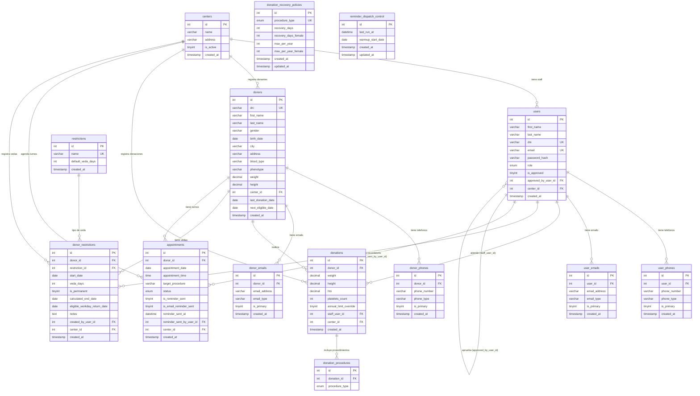

# ERD — Donation System

Diagrama Entidad-Relación (Mermaid `erDiagram`) de la base de datos `donation_system`. Complementa `data-dictionary.md` (detalle de campos) y `casos-de-uso.md` (actores y acciones).

### Notas

- `donors.status` (APTO/EN_VEDA) **no es una columna** — se deriva en cada lectura por el backend (`donors.php`, `search.php`).
- `restrictions` y `donation_recovery_policies` son **globales** (no tienen `center_id`).
- `reminder_dispatch_control` es una tabla single-row (id=1) usada por el lazy sweep.
- Las FKs con `ON DELETE SET NULL` permiten borrar un centro/usuario sin perder datos históricos.