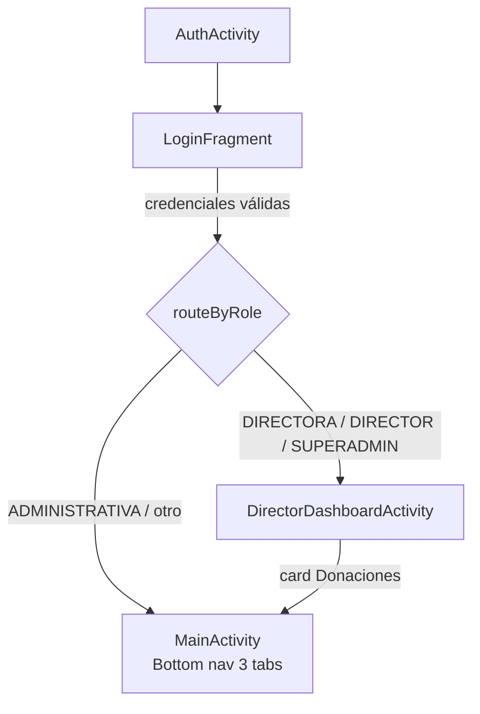

# Flujo de usuario — App Donación (banco de plasma/plaquetas)

Mapa end-to-end de las pantallas por las que pasa el operador, por rol. Complementa `flujo-donaciones.md` (detalle del módulo de donación) y `wiki-design-specification.md` (specs de UI).

---

## 1. Arranque



- Login por email o DNI (`login.php`). Cuentas no aprobadas → 403 "Cuenta pendiente de aprobación por la Dirección."
- La sesión se persiste en `SessionManager` (userId, role, nombre, email, centerId). No hay logout ni restauración automática: la app siempre arranca en login.
- `centerId` se sincroniza con `RetrofitClient` para filtrar por centro (superadmin puede cambiarlo).

---

## 2. Flujo por rol

| Rol | Pantalla inicial | Capacidades |
|---|---|---|
| **SUPERADMIN** | DirectorDashboard (5 cards + selector de centro) | Todo lo de Directora + ABM de centros + vista global de estadísticas/usuarios |
| **DIRECTORA** | DirectorDashboard (5 cards) | Donaciones, Estadísticas, Restricciones, Políticas de recuperación, Usuarios |
| **ADMINISTRATIVA** | MainActivity (3 tabs) | Alta de donante, búsqueda, Agenda, formulario clínico |

---

## 3. Módulo Donaciones

Ver detalle completo en `flujo-donaciones.md` (diagrama Mermaid + puntos clave).

Resumen: 3 entradas convergen en `MainActivity.openClinicalForm()`:
1. **Tab Registrar Donante** → alta de donante (raíz del tab) → `POST donors.php` → recarga por DNI → `DonationsFragment`.
2. **Tab Buscar** → `SearchFragment` (debounce, filtros, paginación) → tap en tarjeta → `GET donors.php` → `DonationsFragment`.
3. **Agenda** → tap en card de turno → `GET donors.php?id=` → `SharedDonorViewModel` con procedimiento preseleccionado → `DonationsFragment`.

En el formulario clínico: hemograma, toggle de procedimiento (Plasma/Plaquetas/Sangre con mutex), advertencias no bloqueantes (recuperación/tope anual), restricciones (checkbox "Aplicar restricciones"), edición in-place y revocación de veda, reagendar turno.

---

## 4. Agenda (turnos)

```mermaid
flowchart TD
    A[AppointmentsFragment] --> B[Calendario mensual + filtro por día]
    B --> C[Lista de turnos del día]
    C -->|tap card (cuerpo)| D[openClinicalForm<br/>donante + procedimiento preseleccionados]
    C -->|icono WhatsApp| E[wa.me + POST send_reminder]
    C -->|icono Email| F[ACTION_SENDTO + POST send_reminder]
    A -->|botón Agendar| G[ScheduleAppointmentFragment<br/>DNI → fecha hábil → hora → procedimiento]
    A -->|botón Dispatch| H[dispatch_reminders manual=true<br/>envío secuencial con pacing]
```

- Turnos solo Lun–Vie, sin mismo día.
- Recordatorio por canal independiente (flags `is_reminder_sent` / `is_email_reminder_sent`).
- Envío masivo: ventana 08:00–13:00, anti-ráfaga, retry, lock.
- Superadmin puede cambiar de centro (selector en dashboard).

---

## 5. Búsqueda

- `SearchFragment`: lista todos los donantes (aptos primero, paginado) al abrir.
- Filtros: texto libre (DNI/nombre/apellido) + grupo/factor (AND implícito).
- Debounce 350 ms, mínimo 2 caracteres.
- Tarjeta muestra: nombre, teléfono, última donación, grupo/factor, estado APTO/EN_VEDA (con motivo), próximo turno.
- Tap en tarjeta → carga donante completo → formulario clínico.
- Botón WhatsApp → confirmación si en veda → `wa.me`.

---

## 6. Perfil de usuario

- Accesible desde "Mi Perfil" (dashboard para directoras, botón top-right para administrativas).
- Editable: nombre, apellido, email, teléfono.
- Read-only: rol, centro.
- Backend: `profile.php` (GET/PUT).

---

## 7. Administración (Directora / Superadmin)

### Usuarios
- Tabs: Pendientes / Activos.
- Aprobar con rol (Administrativa/Directora/Superadmin) + asignar centro.
- Cambiar rol (mutex: no degradar al último Director/Superadmin).
- Eliminar usuario (mismo mutex).

### Restricciones (diccionario)
- CRUD de tipos de veda (nombre + días default).
- Asignar a donante: veda temporal (días → fecha de retorno hábil, salta fines de semana) o permanente.
- Editar in-place, revocar ("QUITAR"), reagendar turno si existe.

### Políticas de recuperación
- CRUD por procedimiento (PLASMA/PLATELETS/BLOOD): días de recuperación y tope anual por género.
- Baseline INCUCAI/SAS sembrado en SQL.
- Consumidas por el formulario clínico (advertencias no bloqueantes).

### Estadísticas
- Rangos: Día / Semana / Mes / Año.
- Tarjetas: total donaciones, por procedimiento, donantes registrados, donantes en veda.
- Gráfico de tendencia (MPAndroidChart).
- Filtro por centro y por staff ("atendido por").

### Centros (solo Superadmin)
- ABM de centros (crear, editar, activar/desactivar).
- Selector de centro en el dashboard (cambia el filtro de todas las requests).

---

## 8. Recordatorios (WhatsApp + Email)

- **Manual:** por turno, botones WhatsApp (`wa.me`) y Email (`ACTION_SENDTO`). Marca flag independiente por canal.
- **Masivo:** botón dispatch (`dispatch_reminders`, `manual=true`) → procesa secuencialmente con pacing (ventana 08:00–13:00, anti-ráfaga, retry, lock).
- **Automático:** scheduler diario 08:00 (tarea `RecordatoriosDonacion`) + lazy sweep (1 vez/día, lock 2 min).
- Proveedor: OpenWA (Baileys, sin Chromium) por defecto; Meta Cloud API implementado pero en pausa.
- Ver `whatsapp-reminders-guide.md` §7 para detalle completo.

---

## Referencias

| Pantalla/Módulo | Archivo principal |
|---|---|
| Login | `views/auth/LoginFragment.java` |
| Dashboard Directora | `views/DirectorDashboardActivity.java` |
| Alta de donante | `views/fragments/DonorFormFragment.java` |
| Búsqueda | `views/fragments/SearchFragment.java` |
| Formulario clínico | `views/fragments/DonationsFragment.java` |
| Agenda | `views/fragments/AppointmentsFragment.java` |
| Perfil | `views/fragments/ProfileFragment.java` |
| Usuarios | `views/fragments/UsersManagementFragment.java` |
| Restricciones | `views/fragments/RestrictionsManagementFragment.java` |
| Políticas | `views/fragments/RecoveryPoliciesFragment.java` |
| Estadísticas | `views/fragments/StatisticsFragment.java` |
| Navegación | `views/MainActivity.java` |
