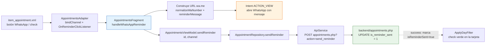

# Guía — Recordatorios por WhatsApp

Implementación de la función de recordatorios de turnos por WhatsApp (y email) del módulo Agenda: cómo funciona, qué archivos la componen y cómo usarla/probarla. Incluye el envío **manual** (el operador toca 💬) y el envío **automático** 2 días antes vía OpenWA (sección 7).

> **Nota (notebook PARDO-NET):** los ajustes de esta guía —base URL al emulador (`10.0.2.2`), host `192.168.0.130` en el cleartext, cuenta `admin`, scripts de sync y BD— están orientados a dejar operativa la app en la **notebook**. La **PC de escritorio** ya funciona con su configuración actual y no requiere estos cambios.



## 1. Cómo funciona (resumen)

El recordatorio por WhatsApp **no se envía desde el backend** ni usa la API comercial de WhatsApp (META). El teléfono del operador hace el trabajo:

1. El operador toca el botón 💬 en una tarjeta de turno.
2. La app arma una URL `https://wa.me/<número>?text=<mensaje URL-encoded>`.
3. La abre con un `Intent ACTION_VIEW`, lo que delega en la app WhatsApp instalada en el mismo teléfono, **predespachada con el mensaje** (el operador solo toca ENVIAR).
4. En paralelo, la app registra en el backend que el recordatorio fue enviado (`is_reminder_sent = 1`) para que el botón no vuelva a aparecer.

> El backend solo **persiste el estado**; el mensaje en sí lo envía WhatsApp del dispositivo.

## 2. Requisitos previos

- **Dispositivo físico** con WhatsApp instalado y sesión iniciada (no funciona bien en emulador).
- Teléfono del donante guardado en `donor_phones` con `is_primary = 1` (la consulta de agenda lo trae como `donorPhone`).
- App apuntando al backend correcto (`DEFAULT_BASE_URL` en `RetrofitClient`), con cleartext HTTP habilitado si usás `http://` (ver `network_security_config` / `usesCleartextTraffic` en el `AndroidManifest.xml`).

## 3. Backend

### 3.1 Esquema de base de datos (`appointments`)

| Columna | Tipo | Rol |
|---|---|---|
| `is_reminder_sent` | `tinyint(1)` | 1 si se envió el recordatorio por WhatsApp |
| `is_email_reminder_sent` | `tinyint(1)` | 1 si se envió por email |
| `reminder_sent_at` | `datetime` | Cuándo se marcó el recordatorio |
| `reminder_sent_by_user_id` | `int` | Qué usuario del sistema lo marcó |

```sql
-- Referencia (en la BD real los campos ya existen)
ALTER TABLE appointments
  ADD COLUMN is_reminder_sent tinyint(1) NOT NULL DEFAULT 0,
  ADD COLUMN is_email_reminder_sent tinyint(1) NOT NULL DEFAULT 0,
  ADD COLUMN reminder_sent_at datetime NULL,
  ADD COLUMN reminder_sent_by_user_id int NULL;
```

### 3.2 Endpoint `backend/appointments.php`

Acción recibida con `POST` (también acepta `GET`) y `action=send_reminder`. El código relevante reside en `backend/appointments.php`:

```php
// POST con body JSON: { "appointmentId": 12, "userId": 1, "channel": "whatsapp" }
if ($action === 'send_reminder') {
    $appointmentId = (int)($data->appointmentId ?? $data->appointment_id ?? 0);
    $userId = isset($data->userId) ? (int)$data->userId : null;
    $channel = strtolower(trim($data->channel ?? 'whatsapp'));

    if ($appointmentId <= 0) {
        sendJsonResponse("error", "Invalid appointment ID", null, 400);
    }

    if ($channel !== 'whatsapp' && $channel !== 'email') {
        sendJsonResponse("error", "Canal de recordatorio inválido", null, 400);
    }

    try {
        $column = $channel === 'email' ? 'is_email_reminder_sent' : 'is_reminder_sent';
        $stmt = $conn->prepare("UPDATE appointments SET $column = 1, reminder_sent_at = NOW(), reminder_sent_by_user_id = :userId WHERE id = :id");
        $stmt->execute(['userId' => $userId, 'id' => $appointmentId]);

        sendJsonResponse("success", "Estado de recordatorio actualizado correctamente", [
            "appointmentId" => $appointmentId,
            "channel" => $channel,
            "isReminderSent" => $channel !== 'email'
        ]);
    } catch(PDOException $e) {
        sendJsonResponse("error", "Database error: " . $e->getMessage(), null, 500);
    }
}
```

**Acepta** JSON `{ appointmentId, userId, channel }`.
**Respuesta OK**: `{ "status": "success", "data": { appointmentId, channel, isReminderSent } }`.

> El `channel` puede ser `whatsapp` o `email`. La misma acción sirve para ambos canales: solo cambia la columna que actualiza.

### 3.3 Lectura (GET) — cómo se trae el estado

La consulta que alimenta la Agenda (`backend/appointments.php`, método GET) incluye:

```php
$a['isReminderSent']       = (bool)$a['is_reminder_sent'];        // si hay turno agendado
$a['isEmailReminderSent']  = (bool)$a['is_email_reminder_sent'];
```

Y el `SELECT` base ya trae el teléfono primario y el email del donante:

```sql
SELECT ... dp.phone_number AS donorPhone, dem.email_address AS donorEmail
FROM appointments a
JOIN donors d ON a.donor_id = d.id
LEFT JOIN donor_phones dp ON dp.donor_id = d.id AND dp.is_primary = 1
LEFT JOIN donor_emails dem ON dem.donor_id = d.id AND dem.is_primary = 1
```

## 4. Android

### 4.1 `ApiService.java`

```java
@POST("appointments.php?action=send_reminder")
Call<ApiResponse<Map<String, Object>>> sendWhatsAppReminder(@Body ReminderRequest request);
```

### 4.2 `models/requests/ReminderRequest.java`

```java
public class ReminderRequest {

    @SerializedName("appointmentId")
    private int appointmentId;

    @SerializedName("userId")
    private Integer userId;          // puede ser null

    @SerializedName("channel")
    private String channel;          // "whatsapp" | "email"

    public ReminderRequest() {
    }

    public ReminderRequest(int appointmentId, Integer userId) {
        this(appointmentId, userId, "whatsapp");
    }

    public ReminderRequest(int appointmentId, Integer userId, String channel) {
        this.appointmentId = appointmentId;
        this.userId = userId;
        this.channel = channel;
    }

    // getters y setters...
}
```

### 4.3 `repositories/AppointmentRepository.java`

```java
public void sendReminder(ReminderRequest request, Callback<ApiResponse<Map<String, Object>>> callback) {
    Call<ApiResponse<Map<String, Object>>> call = apiService.sendWhatsAppReminder(request);
    call.enqueue(callback);
}
```

### 4.4 `viewmodels/AppointmentsViewModel.java`

```java
public void sendReminder(int appointmentId) {
    sendReminder(appointmentId, "whatsapp");      // default: WhatsApp
}

public void sendReminder(int appointmentId, String channel) {
    reminderResult.postValue(Resource.loading());
    appointmentRepository.sendReminder(
            new ReminderRequest(appointmentId, getCurrentUserReminderId(), channel),
            new Callback<ApiResponse<Map<String, Object>>>() {
                @Override
                public void onResponse(Call<ApiResponse<Map<String, Object>>> call, Response<ApiResponse<Map<String, Object>>> response) {
                    if (response.isSuccessful() && response.body() != null) {
                        ApiResponse<Map<String, Object>> body = response.body();
                        if (body.isSuccess()) {
                            reminderResult.postValue(Resource.success(body.getData()));
                        } else {
                            reminderResult.postValue(Resource.error(
                                body.getMessage() != null ? body.getMessage() : "No se pudo actualizar el recordatorio"));
                        }
                    } else {
                        reminderResult.postValue(
                            Resource.error("No se pudo actualizar el recordatorio: " + response.code()));
                    }
                }

                @Override
                public void onFailure(Call<ApiResponse<Map<String, Object>>> call, Throwable t) {
                    reminderResult.postValue(Resource.error("Error de red: " + t.getMessage()));
                }
            });
}
```

El `userId` se inyecta con `viewModel.setCurrentUserId(...)` desde `AppointmentsFragment` usando `SessionManager`:

```java
viewModel.setCurrentUserId(SessionManager.getInstance(requireContext()).getUserIdOrNull());
```

### 4.5 `views/fragments/AppointmentsFragment.java` (lo más importante)

El fragmento que muestra la Agenda conecta el click del botón con el envío real:

```java
// Conexión adapter → acciones (en setupRecyclers)
appointmentsAdapter = new AppointmentsAdapter((appointment, channel) -> {
    if ("email".equals(channel)) {
        handleEmailReminder(appointment);
    } else {
        handleWhatsAppReminder(appointment);
    }
});
```

**Handler de WhatsApp:**

```java
private void handleWhatsAppReminder(Appointment appointment) {
    if (isReminderInFlight()) {
        return;                        // evita doble envío mientras hay una petición pendiente
    }
    String phoneDigits = appointment.getDonorPhone() == null ? "" : appointment.getDonorPhone().replaceAll("[^0-9]", "");
    if (phoneDigits.isEmpty()) {
        Toast.makeText(requireContext(), R.string.msg_reminder_error, Toast.LENGTH_LONG).show();
        return;
    }

    String url;
    try {
        url = "https://wa.me/" + normalizeWaNumber(phoneDigits) + "?text="
                + URLEncoder.encode(reminderMessage(appointment, false), "UTF-8");
    } catch (Exception e) {
        Toast.makeText(requireContext(), R.string.msg_reminder_error, Toast.LENGTH_LONG).show();
        return;
    }

    Intent intent = new Intent(Intent.ACTION_VIEW, Uri.parse(url));
    try {
        startActivity(intent);
    } catch (ActivityNotFoundException e) {
        Toast.makeText(requireContext(), R.string.msg_whatsapp_not_installed, Toast.LENGTH_LONG).show();
        return;
    } catch (Exception e) {
        Toast.makeText(requireContext(), R.string.msg_whatsapp_not_installed, Toast.LENGTH_LONG).show();
        return;
    }

    pendingReminderAppointmentId = appointment.getId();
    pendingReminderChannel = "whatsapp";
    viewModel.sendReminder(appointment.getId(), "whatsapp");
}
```

**Normalización del número (prefijo país 54, Argentina):**

```java
private String normalizeWaNumber(String phoneDigits) {
    if (phoneDigits == null) return "";
    // Largo 10-12 sin prefijo de país → agrega 54
    if (phoneDigits.length() >= 10 && phoneDigits.length() <= 12 && !phoneDigits.startsWith("54")) {
        return "54" + phoneDigits;
    }
    return phoneDigits;
}
```

> `wa.me` exige el número en formato internacional **sin** `+`, espacios ni guiones (ej. `5492215550001`).

**Armado del mensaje:**

```java
private String reminderMessage(Appointment appointment, boolean email) {
    String dateText = appointment.getAppointmentDate();
    try {
        dateText = LocalDate.parse(appointment.getAppointmentDate()).format(DISPLAY_DATE);  // dd/MM/yyyy
    } catch (Exception ignored) {
    }
    int formatRes = email ? R.string.email_reminder_format : R.string.whatsapp_reminder_format;
    return getString(formatRes,
            appointment.getDonorName(),
            procedureLabel(appointment.getTargetProcedure()),
            dateText,
            appointment.getAppointmentTime());
}

private String procedureLabel(String code) {
    if (code == null) return "";
    switch (code.toUpperCase()) {
        case "PLASMA":    return getString(R.string.procedure_plasma);     // "Plasma"
        case "PLATELETS": return getString(R.string.procedure_platelets);  // "Plaquetas"
        case "BLOOD":     return getString(R.string.procedure_blood);      // "Sangre"
        default:          return code;
    }
}
```

**Guard anti doble petición + limpieza de estado pendiente:**

```java
private boolean isReminderInFlight() {
    return pendingReminderAppointmentId != null;
}
```

**Observador que marca la tarjeta al confirmar el backend:**

```java
viewModel.getReminderResult().observe(getViewLifecycleOwner(), resource -> {
    if (resource == null) return;
    if (resource.status == Resource.Status.SUCCESS) {
        if (pendingReminderAppointmentId != null) {
            for (Appointment appointment : allAppointments) {
                if (appointment.getId() == pendingReminderAppointmentId) {
                    if ("email".equals(pendingReminderChannel)) {
                        appointment.setEmailReminderSent(true);
                    } else {
                        appointment.setReminderSent(true);
                    }
                    break;
                }
            }
        }
        pendingReminderAppointmentId = null;
        pendingReminderChannel = null;
        applyDayFilter(selectedDay);                    // recarga lista → check verde
        Toast.makeText(requireContext(), R.string.msg_reminder_sent, Toast.LENGTH_SHORT).show();
    } else if (resource.status == Resource.Status.ERROR && resource.message != null) {
        pendingReminderAppointmentId = null;
        pendingReminderChannel = null;
        Toast.makeText(requireContext(), resource.message, Toast.LENGTH_LONG).show();
    }
});
```

### 4.6 `adapters/AppointmentsAdapter.java`

Define el callback y decide mostrar botón o check según `isReminderSent`:

```java
public interface OnReminderClickListener {
    void onReminderClick(Appointment appointment, String channel);
}
```

```java
private void bindChannel(boolean sent, boolean sameDay, MaterialButton button, ImageView check,
                         int contentDescriptionRes, String channel, Appointment appointment) {
    if (sent) {
        check.setVisibility(View.VISIBLE);   // ya enviado → check verde
        button.setVisibility(View.GONE);
        return;
    }
    check.setVisibility(View.GONE);
    button.setVisibility(View.VISIBLE);
    button.setContentDescription(itemView.getContext().getString(contentDescriptionRes));
    button.setEnabled(!sameDay);             // el mismo día del turno se deshabilita
    button.setAlpha(sameDay ? 0.4f : 1f);
    button.setOnClickListener(v -> {
        if (reminderListener != null) {
            reminderListener.onReminderClick(appointment, channel);
        }
    });
}
```

El `DiffUtil` compara también los flags para refrescar solo lo necesario:

```java
@Override
public boolean areContentsTheSame(Appointment oldItem, Appointment newItem) {
    return oldItem.isReminderSent() == newItem.isReminderSent()
            && oldItem.isEmailReminderSent() == newItem.isEmailReminderSent()
            && Objects.equals(oldItem.getAppointmentTime(), newItem.getAppointmentTime());
}
```

### 4.7 `res/layout/item_appointment.xml` (extracto)

```xml
<LinearLayout
    android:id="@+id/layoutReminderActions"
    android:layout_width="wrap_content"
    android:layout_height="wrap_content"
    android:orientation="horizontal"
    android:gravity="center_vertical">

    <!-- Botón WhatsApp -->
    <com.google.android.material.button.MaterialButton
        android:id="@+id/buttonSendWhatsApp"
        style="@style/Widget.Material3.Button.IconButton"
        android:contentDescription="@string/cd_send_whatsapp"
        app:icon="@drawable/ic_whatsapp"
        app:iconSize="24dp" />

    <!-- Botón email -->
    <com.google.android.material.button.MaterialButton
        android:id="@+id/buttonSendEmail"
        style="@style/Widget.Material3.Button.IconButton"
        android:contentDescription="@string/cd_send_email"
        app:icon="@drawable/ic_mail"
        app:iconSize="24dp" />

    <!-- Checks verdes (aparecen cuando el recordatorio ya se marcó) -->
    <ImageView
        android:id="@+id/imageViewReminderWhatsAppChecked"
        android:layout_width="40dp"
        android:layout_height="40dp"
        android:src="@drawable/ic_check"
        android:tint="@color/aptitude_green"
        android:visibility="gone" />

    <ImageView
        android:id="@+id/imageViewReminderEmailChecked"
        android:layout_width="40dp"
        android:layout_height="40dp"
        android:src="@drawable/ic_check"
        android:tint="@color/aptitude_green"
        android:visibility="gone" />
</LinearLayout>
```

### 4.8 `res/values/strings.xml`

```xml
<string name="whatsapp_reminder_format">Hola *%1$s*, te recordamos tu turno para donación de *%2$s* el día %3$s a las *%4$s* hs.</string>

<string name="msg_reminder_sent">Recordatorio enviado</string>
<string name="msg_reminder_error">No se pudo actualizar el recordatorio</string>
<string name="msg_whatsapp_not_installed">WhatsApp no está instalado</string>
<string name="msg_no_donor_email">El donante no tiene email registrado</string>
<string name="msg_email_not_available">No hay ninguna app de correo instalada</string>

<string name="cd_send_whatsapp">Enviar recordatorio por WhatsApp</string>
<string name="cd_send_email">Enviar recordatorio por email</string>
```

> Los `*asteriscos*` del mensaje de WhatsApp se renderizan como **negrita** en el chat.

## 5. Guía de pruebas

Prueba manual de extremo a extremo:

1. **Datos**: crear/verificar un turno cuyo donante tenga un teléfono real (`donor_phones`). Podés reusar el seed existente.
2. **Backend**: arrancar el backend (XAMPP) y levantar la app apuntando a la base URL correcta.
3. **Agenda**: en la app, ir a Agenda → buscar el día con el turno → tocar el botón 💬 de la tarjeta.
4. **Resultados esperados**:
   - Se abre WhatsApp con el mensaje predespachado («Hola *Nombre*…»). El operador toca ENVIAR.
   - Al volver a la app, el botón 💬 desaparece y aparece un **check verde**.
   - Si se recarga la Agenda (salir y volver), el check persiste (`is_reminder_sent = 1` en BD).
5. **Verificación en BD**: consultar `SELECT is_reminder_sent, reminder_sent_at, reminder_sent_by_user_id FROM appointments WHERE id = <id>`.

### Casos sin flujo esperado

- **Sin teléfono**: toast «No se pudo actualizar el recordatorio» y no abre nada.
- **WhatsApp no instalado**: toast «WhatsApp no está instalado».
- **Mismo día del turno**: botón gris/deshabilitado (regla `sameDay`), no se puede enviar.
- **Ya enviado**: botón reemplazado por check verde en la tarjeta.

## 6. Problemas comunes (FAQ)

**Q: No abre WhatsApp.** → Revisar `normalizeWaNumber`: el número debe quedarse en formato internacional solo dígitos (ej. `5492215550001`). Si el teléfono del donante está guardado con guiones/espacios, `replaceAll("[^0-9]","")` los limpia. Además el teléfono debe tener `is_primary = 1` para llegar como `donorPhone`.

**Q: Abre WhatsApp pero sin mensaje.** → `URLEncoder.encode(..., "UTF-8")` es obligatorio para el `?text=`. Sin escapar, los `*`, `ñ` o espacios rompen el texto.

**Q: El check no aparece tras enviar.** → El backend debe responder `success`. Si falla la red (verificar BASE_URL y cleartext), el flujo muestra toast de error y no marca la tarjeta. Probar la misma acción con un cliente HTTP (Postman/Insomnia) apuntando a `POST appointments.php?action=send_reminder` con body JSON.

**Q: El botón no permite enviar (gris).** → Es el comportamiento `sameDay`: el mismo día del turno está deshabilitado a propósito. Probar con un turno de otro día.

**Q: Reminder queda persistido pero el check solo se ve tras recargar.** → El `DiffUtil` compara `isReminderSent`; si el listado no se refresca en memoria, forzar `applyDayFilter(selectedDay)` después del `SUCCESS` (ya está implementado en `AppointmentsFragment`).

**Q: `reminder_sent_by_user_id` queda NULL.** → Ocurre si el usuario no tiene ID cargado en sesión. Verificar `SessionManager.getUserIdOrNull()` y que `setCurrentUserId()` se llame antes de `sendReminder`.

## 7. Recordatorios automáticos (OpenWA)

Además del envío **manual** (sección 4, el operador toca 💬), el sistema puede enviar recordatorios **automáticamente 2 días antes** del turno, sin intervención humana. Lo hace un dispatcher CLI en el backend que habla con **OpenWA** (gateway open-source de WhatsApp, Node + Baileys) corriendo en el mismo servidor.

```mermaid
flowchart TD
    A[Turno agendado] --> B{¿2 días antes?}
    B -->|cron diario 08:00<br/>off en notebook| C[send_reminders.php]
    B -->|GET agenda<br/>lazy sweep<br/>off en notebook| C
    B -->|botón manual app<br/>único en notebook| C

    C --> D{¿dentro de ventana 08-13?}
    D -->|no| E[modo compact: delay corto]
    D -->|sí| F[distribuye en la ventana<br/>con jitter]
    E --> G{anti-ráfaga<br/>>15 msgs?}
    F --> G
    G -->|no| H[delay 20-60s entre msgs]
    G -->|sí| I[lotes ≥90 min]

    H --> J[warm-up + tope diario]
    I --> J
    J --> K[whatsapp_sender.php<br/>sendWhatsappText]
    K --> L[OpenWA :2785/api<br/>POST sessions/{id}/messages/send-text]
    L -->|ok| M[marca is_reminder_sent=1<br/>+ reminder_sent_at]
    L -->|falla| N[reintento único 5 min]
    N -->|falla| O[deja pendiente + log]

    style C fill:#e3f2fd,stroke:#1565c0
    style L fill:#fff3e0,stroke:#ef6c00
    style M fill:#e8f5e9,stroke:#2e7d32
    style O fill:#ffebee,stroke:#c62828
```

### 7.1 Estrategia anti-baneo

OpenWA usa la API **no oficial** de WhatsApp (Baileys, vía WhatsApp Web). El número puede ser **baneado** si se comporta como robot. Por eso el dispatcher implementa:

| Mecanismo | Qué hace | Config |
|---|---|---|
| **Ventana horaria** | Solo envía entre 08:00 y 13:00 (horario del banco) | `REMINDER_WINDOW_START` / `END` |
| **Jitter** | Reparte los envíos dentro de la ventana en vez de mandarlos todos juntos | (automático) |
| **Anti-ráfaga** | ≤15 mensajes → separación 20-60s. >15 → se parten en lotes de ≥90 min | `LARGE_BATCH_THRESHOLD`, `BATCH_SPREAD_MIN_SECONDS` |
| **Warm-up** | Limita el volumen los primeros días de un número nuevo (arranca en 10/día y sube) | `WARMUP_DAILY_MAX_DAY1`, `WARMUP_DAILY_MAX_STEP` |
| **Tope diario** | Máximo de mensajes por día | `REMINDER_DAILY_MAX` |
| **Saludos variados** | Aleatoriza el saludo para que no sean mensajes idénticos | `$REMINDER_GREETINGS` |
| **Reintento único** | Si falla, reintenta una vez a los 5 min; si no, lo deja pendiente | `REMINDER_RETRY_DELAY_SECONDS` |

> **Regla transversal del sistema**: *solo se advierte, nunca se bloquea*. Si un turno no se puede recordar, se loguea y queda pendiente; nunca se impide agendar ni operar.

> **Corte de emergencia**: ante un imprevisto (bug, envío masivo accidental) se frena todo en segundos con **Logout de la sesión** en el dashboard de OpenWA (desvincula el número e inhabilita el envío; para re-vincular hay que volver a escanear el QR) o con el **kill-switch** `REMINDER_ENABLED=false` en `config_reminders.php` (no desvincula el número, solo corta el dispatcher y el botón de la app).

### 7.2 Configuración — `backend/config_reminders.php`

Todos los valores son **editables**. Lo importante:

```php
define('REMINDER_PROVIDER', 'openwa');          // 'openwa' | 'meta'
define('REMINDER_ENABLED', true);               // kill-switch: false corta TODO envío sin desvincular el número
define('REMINDER_WINDOW_START', '08:00');
define('REMINDER_WINDOW_END', '13:00');
define('REMINDER_DAY_OFFSET', 2);               // 2 días antes
define('REMINDER_MESSAGE_TEMPLATE', '{greeting} Tenés un turno de {procedure} el {date} a las {time}.');

$REMINDER_GREETINGS = [
    'Hola {donorName}!',
    'Hola {donorName}, ¿cómo estás?',
    'Estimado/a {donorName}:',
    '{donorName}, te esperamos en el Banco de Sangre.',
];

// OpenWA (proveedor actual). Las credenciales NO se versionan:
// se definen en config_reminders_override.php (gitignored). Ver §7.8.
define('OPENWA_BASE_URL', 'http://localhost:2785');       // default del código
// OPENWA_API_KEY / OPENWA_SESSION_ID -> config_reminders_override.php

// Pacing
define('MANUAL_DELAY_MIN', 20);
define('MANUAL_DELAY_MAX', 60);
define('BATCH_SPREAD_MIN_SECONDS', 5400);       // 90 min
define('LARGE_BATCH_THRESHOLD', 15);
define('WARMUP_DAILY_MAX_DAY1', 10);
define('WARMUP_DAILY_MAX_STEP', 10);
define('REMINDER_DAILY_MAX', 50);
define('REMINDER_RETRY_DELAY_SECONDS', 300);

// Ruta del PHP-CLI (ver 7.7)
define('PHP_CLI_PATH', '');
```

Placeholders del template: `{greeting}`, `{donorName}`, `{procedure}`, `{date}`, `{time}`.

### 7.3 Dispatcher — `backend/send_reminders.php` (CLI)

Solo se ejecuta por línea de comandos (no es accesible por HTTP).

```bash
# cron: modo automático (respeta ventana horaria)
php send_reminders.php

# envío manual (ignora ventana, delay corto)
php send_reminders.php manual

# simulación: no envía ni marca nada, solo imprime
php send_reminders.php dryrun
php send_reminders.php manual dryrun   # el dryrun no envía; 'manual' no cambia la salida
```

**Qué hace**:
1. Toma la fecha `HOY + REMINDER_DAY_OFFSET` y busca turnos `SCHEDULED` con `is_reminder_sent = 0` (no filtra por teléfono en el SELECT; los que no tienen teléfono se omiten al enviar, sin marcarlos como enviados).
2. Aplica warm-up / tope diario.
3. Calcula los delays (ventana + jitter, o compacto en modo manual).
4. Envía cada mensaje vía `sendWhatsappText()`, con anti-ráfaga y reintento único.
5. Marca `is_reminder_sent = 1` y `reminder_sent_at = NOW()` en los exitosos.
6. Escribe todo en `backend/logs/reminders.log`.
7. Usa un **lock** (`backend/logs/reminders.lock`) para evitar dos dispatchers simultáneos.

Formato del log:

```
[2026-10-11 08:35:26] [DRYRUN] Objetivo: 2026-10-13 | Candidatos: 3
[2026-10-11 08:36:01] [CRON] Turno #12 -> ENVIADO a 542235100017
[2026-10-11 08:36:41] [CRON] Resumen: enviados=3, fallidos=0, procesados=3
```

### 7.4 Adaptador de envío — `backend/whatsapp_sender.php`

Abstrae el proveedor. Cambiar de OpenWA a Meta es cambiar `REMINDER_PROVIDER` (y completar credenciales), sin tocar el dispatcher.

```php
sendWhatsappText($number, $text, $params = null): array
// -> ['ok' => bool, 'message' => string, 'raw' => mixed]
//    $params = variables de plantilla Meta; OpenWA las ignora (usa $text)

normalizeWaNumber(string $phone): string
// agrega prefijo país 54 si falta (Argentina)

sendViaOpenWa(...)   // POST {OPENWA_BASE_URL}/api/sessions/{OPENWA_SESSION_ID}/messages/send-text
// Header: X-API-Key: <OPENWA_API_KEY>   (NO es Bearer)
// Body:   { "chatId": "<número>@c.us", "text": "..." }   -> 201 = enviado
sendViaMeta(...)     // implementado (Fase 2), INACTIVO: Meta EN PAUSA — ver §7.11
```

> **Estado de Meta (12-oct-2026): EN PAUSA.** El Business Portfolio quedó restringido por hold de cuenta FB nueva y no se pudo crear la WABA/test number. Decisión del usuario: **OpenWA es el proveedor operativo** (REMINDER_PROVIDER = `openwa`). El código Meta está listo e inerte; se retomará si el hold se libera.

### 7.5 Disparo desde la app y lazy sweep — `backend/appointments.php`

- **Botón manual** en la Agenda: `POST appointments.php?action=dispatch_reminders` con body `{ "manual": "true" }`. Lanza `send_reminders.php manual` en background y responde enseguida.

  ```json
  { "status": "success", "message": "Dispatch de recordatorios lanzado correctamente",
    "data": { "dispatched": true, "mode": "manual" } }
  ```

- **Lazy sweep**: cuando la app hace el `GET` de la Agenda, el backend revisa si hoy ya corrió el dispatch (`reminder_dispatch_control.last_run_at`) y, de no ser así **y estando dentro de la ventana 08:00–13:00**, corre el dispatcher una vez (con un lock `logs/reminders.sweep` de 2 min para que varios requests no lo disparen a la vez). Es el **respaldo sin cron**: si nadie abre la app, no ocurre; por eso se combina con cron. Se puede desactivar por máquina con `REMINDER_LAZY_SWEEP_ENABLED = false` (en `config_reminders_override.php`).

> **Notebook PARDO-NET (cambio exclusivo de este dispositivo):** aquí el **scheduler y el lazy
> sweep están desactivados** — la tarea `RecordatoriosDonacion` fue eliminada (`schtasks /Delete /TN
> "RecordatoriosDonacion" /F`) y `REMINDER_LAZY_SWEEP_ENABLED = false`. El **único disparo** es el
> **botón de la Agenda**. El envío sigue siendo pausado/secuencial (mismos `MANUAL_DELAY_MIN/MAX` y
> `BATCH_SPREAD_MIN_SECONDS`). Para reactivar: `php backend/install_scheduler.php` y flag en `true`.
> La **PC de escritorio** mantiene scheduler + lazy sweep.

### 7.6 Instalador del scheduler — `backend/install_scheduler.php`

Script CLI que registra la tarea diaria según el SO (`PHP_OS_FAMILY`):

```bash
php install_scheduler.php
```

- **Windows** → `schtasks` (Task Scheduler), dispara `send_reminders.php` todos los días a las 08:00.
- **Linux** → agrega una línea a `crontab`.

> El scheduler corre **en el servidor** (donde vive el backend + OpenWA), no en las PCs de los operadores.
>
> **Notebook PARDO-NET:** el scheduler está **eliminado** (no correr `install_scheduler.php`). El único
> disparo es el botón de la Agenda. Para revertir: correr este instalador y poner
> `REMINDER_LAZY_SWEEP_ENABLED = true` en `config_reminders_override.php`.

### 7.7 Requisito: binario PHP-CLI (`PHP_CLI_PATH`)

Cuando la app dispara el dispatch, el request lo atiende **Apache**, y bajo Apache `PHP_BINARY` apunta a `httpd.exe`, no a `php.exe`. Como `httpd.exe -f send_reminders.php` no sirve, el código resuelve el PHP-CLI con `resolvePhpCliBinary()`:

1. `PHP_CLI_PATH` de `config_reminders.php` si está seteado y existe.
2. Si ya corre por CLI → `PHP_BINARY`.
3. Autodetección (XAMPP: `<xampp>\php\php.exe`; Linux: `php` en PATH).

Si el envío manual desde la app no loguea nada, revisar esta ruta (dejar `PHP_CLI_PATH` explícito).

> **Windows**: el lanzamiento usa `start "" /B` (el `""` es obligatorio: sin él, `start` interpreta la ruta a `php.exe` como **título de ventana** y no ejecuta nada).

### 7.8 Instalación de OpenWA

En el servidor (Node.js instalado, versión >= 22.19):

```bash
git clone https://github.com/rmyndharis/OpenWA.git
cd OpenWA
npm install        # compila better-sqlite3 (ver nota Windows abajo)
# .env (según instalación)
NODE_ENV=production
PORT=2785
ENGINE_TYPE=baileys         # no requiere el celular encendido
DATABASE_TYPE=sqlite
npm run build && npm start
```

**Primer arranque**: OpenWA **genera una API key automáticamente** y la imprime en el log (`API Key (newly created): owa_k1_...`). Copiarla a `OPENWA_API_KEY` en `backend/config_reminders_override.php` (gitignored; **no** en `config_reminders.php`, que está versionado).

**Crear y vincular la sesión** (API REST, o hacerlo desde el dashboard):

```bash
# 1) crear sesión (nombre alfanumérico + guiones, min 3 chars)
curl -X POST http://localhost:2785/api/sessions \
     -H "X-API-Key: <api-key>" -H "Content-Type: application/json" \
     -d '{"name":"donacion"}'
#    -> {"id":"<SESSION_ID>","status":"created",...}

# 2) iniciarla
curl -X POST http://localhost:2785/api/sessions/<SESSION_ID>/start \
     -H "X-API-Key: <api-key>"

# 3) obtener el QR (data URL base64) y escanearlo con el WhatsApp del banco
curl http://localhost:2785/api/sessions/<SESSION_ID>/qr \
     -H "X-API-Key: <api-key>"
#    -> {"qrCode":"data:image/png;base64,...","status":"qr_ready"}
#    Cuando queda:  {"status":"ready","phone":"5492...","...":...}
```

Escanearlo con WhatsApp → Ajustes → Dispositivos vinculados → Vincular un dispositivo. Es el **único paso manual irreemplazable**. La sesión se guarda y sobrevive reinicios. Copiar el `<SESSION_ID>` a `OPENWA_SESSION_ID`.

**Health check**:

```bash
curl http://localhost:2785/api/health
# -> {"status":"ok","version":"0.24.0"}
```

**Contrato de envío** (el que usa `sendViaOpenWa()`):

```
POST http://localhost:2785/api/sessions/<SESSION_ID>/messages/send-text
Header: X-API-Key: <api-key>
Body:   { "chatId": "541122334455@c.us", "text": "Hola! ..." }   (chatId = destinatario, no el número remitente)
Respuesta: 201 -> {"messageId":"..."}   (aceptado; se verifica por el estado del mensaje)
Errores: 409 sesión no lista | 400 petición inválida | 503 no se pudo resolver el destinatario
```

> Al autenticarse con la **API key** (no Bearer) y enviar vía **sesión + chatId**, un fallo de envío **no marca** el turno como enviado: queda pendiente para la próxima corrida.

> **Windows**: `npm install` compila `better-sqlite3` desde fuente → necesita **MSVC (cl.exe)** + **Python 3**. Abrir consola de VS (`Developer Command Prompt`) o correr `vcvars64.bat` antes, y definir `PYTHON` al binario de Python. (OpenWA no consume el celular encendido: Baileys usa la cuenta vía WhatsApp Web.)

### 7.9 Esquema de base de datos

Además de las columnas de la sección 3.1, el dispatch automático usa:

```sql
CREATE TABLE IF NOT EXISTS reminder_dispatch_control (
  id INT PRIMARY KEY DEFAULT 1,
  last_run_at DATETIME NULL,
  warmup_start_date DATE NULL,
  created_at TIMESTAMP DEFAULT CURRENT_TIMESTAMP,
  updated_at TIMESTAMP DEFAULT CURRENT_TIMESTAMP ON UPDATE CURRENT_TIMESTAMP
);
-- fila única
INSERT IGNORE INTO reminder_dispatch_control (id) VALUES (1);
```

`sql/migration_reminders_control.sql` crea esta tabla.

### 7.10 Prueba de extremo a extremo (E2E)

1. **Migración**: aplicar `sql/migration_reminders_control.sql`.
2. **Dryrun** (no envía nada):

   ```bash
   php backend/send_reminders.php dryrun
   ```
   Debe listar los candidatos de HOY+2 con saludo, nombre, procedimiento, fecha y teléfono normalizado.
3. **OpenWA arriba** y sesión escaneada.
4. **Turno HOY+2**: asegurar un turno para dentro de 2 días con teléfono real y `is_reminder_sent = 0`.
5. **Envío manual desde la app**: Agenda → botón enviar → toast «Envío de recordatorios iniciado». En segundos, `logs/reminders.log` muestra `[MANUAL]` y los envíos.
6. **Verificación**:
   - El mensaje llega al WhatsApp del donante.
   - `SELECT is_reminder_sent, reminder_sent_at FROM appointments WHERE id = <id>;` → `1`.

### 7.11 Migrar a Meta Cloud API (pago) — EN PAUSA

> **12-oct-2026:** migración pausada por decisión del usuario (hold de cuenta FB nueva impide crear la WABA). **OpenWA es el proveedor operativo actual.** Estas instrucciones quedan para cuando se retome. El código de la Fase 2 ya está implementado e inerte.

Cuando se quiera dejar OpenWA (no oficial, riesgo de baneo) por la **API oficial** de Meta:

1. Poner `REMINDER_PROVIDER = 'meta'` en `config_reminders.php`.
2. Completar credenciales en el bloque `META_*` de `config_reminders.php`: `META_TOKEN`, `META_PHONE_NUMBER_ID` (y `META_TEMPLATE_NAME='recordatorio_turno'`). El código de `sendViaMeta()` ya está implementado.
3. **Requisito importante**: Meta **no acepta texto libre** para mensajes iniciados por el negocio; hay que usar **plantillas pre-aprobadas** (templates). Los saludos aleatorios **no** son posibles; se usa una plantilla fija con variables.
4. Costo: los mensajes proactivos (fuera de la ventana de 24 h) se cobran.

El resto del sistema (dispatcher, cron, marcado en BD, app) **no cambia**.

### 7.12 Modo dual / Fallback rápido (OpenWA ↔ Meta) — Cheat-sheet

Ambos proveedores conviven: el activo lo elige `REMINDER_PROVIDER` en `backend/config_reminders.php`. Cambiar de uno a otro toma **<1 minuto** y no toca app, BD ni scheduling.

**Números**: Meta usa el número dedicado del banco; OpenWA usa el chip dedicado **5492233556122** (desde 12-oct-2026; el 5492235024735 volvió al uso personal y quedó fuera del sistema). Nunca registrar el mismo número en dos proveedores.

```php
// backend/config_reminders.php
define('REMINDER_PROVIDER', 'openwa');   // 'openwa' (gratis, no oficial) | 'meta' (pago, oficial)
```

| Acción | Pasos |
|---|---|
| ⬅ OpenWA → Meta | 1) Editar `config_reminders.php`: `REMINDER_PROVIDER = 'meta'` · 2) verificar `META_TOKEN` / `META_PHONE_NUMBER_ID` / `META_TEMPLATE_NAME` · 3) confirmar plantilla APPROVED · 4) `php send_reminders.php dryrun` antes de soltar |
| ⬅ Meta → OpenWA | 1) Editar: `REMINDER_PROVIDER = 'openwa'` · 2) verificar servicio `OpenWA-Gateway` Running · 3) `curl http://localhost:2785/api/health` → `{"status":"ok"}` · 4) `php send_reminders.php dryrun` |

**Gateway como servicio Windows (`OpenWA-Gateway`, instalado con NSSM)** — arranca con el equipo, se reinicia solo si crashea, sin ventana de consola:

| Operación | Comando |
|---|---|
| Ver estado | `Get-Service OpenWA-Gateway` (esperado: Running / Automatic) |
| Arrancar | `Start-Service OpenWA-Gateway` |
| Detener (mantenimiento) | `Stop-Service OpenWA-Gateway` (NUNCA `taskkill`: el servicio lo relanza) |
| Logs | `C:\Users\games\openwa\openwa.out.log` / `openwa.err.log` |
| Verificar | `curl http://localhost:2785/api/health` → `{"status":"ok"}` |
| Dashboard QR/sesiones | `C:\Users\games\openwa\openwa-dashboard.bat` → UI en `http://localhost:2785` (bundled, solo cuando se administra) |

(Histórico: `start-openwa.bat` quedó obsoleto para el gateway; `stop-openwa.bat` solo por emergencia.)

> **Notebook PARDO-NET (14-oct-2026):** OpenWA instalado en `C:\Users\games\openwa` — Node 24 LTS,
  Python 3.12, NSSM (winget); `.env` con `ENGINE_TYPE=baileys` + `DATABASE_TYPE=sqlite`;
  `PUPPETEER_SKIP_DOWNLOAD=1` (sin Chromium); servicio `OpenWA-Gateway` (auto-start). Sesión
  `donacion` (chip `5492233556122`); API key y session id en
  `backend/config_reminders_override.php`. El dashboard está **bundled**: se sirve en
  `http://localhost:2785` (no hace falta el dev server de :2886).
>
> **Sin disparos automáticos (cambio exclusivo de este dispositivo):** la tarea
> `RecordatoriosDonacion` fue **eliminada** y `REMINDER_LAZY_SWEEP_ENABLED = false`. Los
> recordatorios se envían **solo tocando el botón** de la Agenda, de forma **pausada/secuencial**.
> La PC de escritorio mantiene scheduler + lazy sweep.

**Reglas operativas**:
- `send_reminders.php` arma **texto + variables** siempre: OpenWA usa el texto libre, Meta las variables de la plantilla (`sendWhatsappText($number, $text, $params)`).
- `is_reminder_sent` es **compartido** → conmutar no duplica ni pierde envíos.
- Antes de cada conmutación: correr `php send_reminders.php dryrun` y revisar `backend/logs/reminders.log`.
- Fallback típico: ante un rechazo/error de Meta, volver a OpenWA; ante un baneo de OpenWA, pasar a Meta.

## Referencias

| Capa | Archivo |
|---|---|
| Backend (manual) | `backend/appointments.php` |
| Config automáticos | `backend/config_reminders.php` |
| Dispatcher automático | `backend/send_reminders.php` |
| Adaptador de envío | `backend/whatsapp_sender.php` |
| Instalador scheduler | `backend/install_scheduler.php` |
| Migración BD | `sql/migration_reminders_control.sql` |
| Endpoint cliente | `app/src/main/java/com/francomartinez/donationsystem/api/ApiService.java` |
| Payload | `app/src/main/java/com/francomartinez/donationsystem/models/requests/ReminderRequest.java` |
| Repository | `app/src/main/java/com/francomartinez/donationsystem/repositories/AppointmentRepository.java` |
| ViewModel | `app/src/main/java/com/francomartinez/donationsystem/viewmodels/AppointmentsViewModel.java` |
| Lógica de envío | `app/src/main/java/com/francomartinez/donationsystem/views/fragments/AppointmentsFragment.java` |
| Lista + botones | `app/src/main/java/com/francomartinez/donationsystem/adapters/AppointmentsAdapter.java` |
| Layout de tarjeta | `app/src/main/res/layout/item_appointment.xml` |
| Textos | `app/src/main/res/values/strings.xml` |